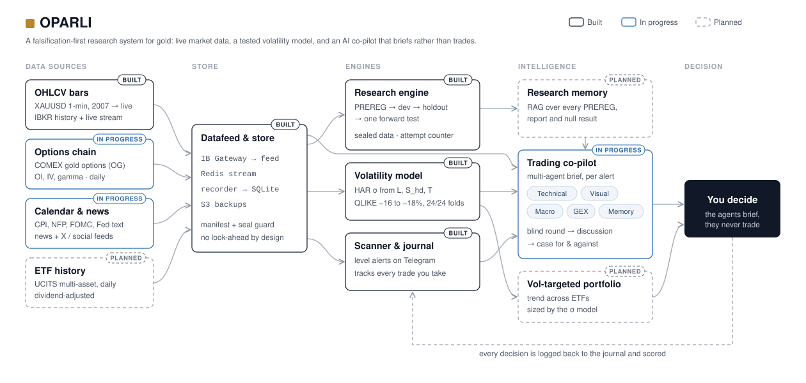

<p align="center"></p>

# OPARLI

A falsification-first research system for commodities, currently validated on
gold (XAUUSD) only.

## What it found

Every row is the verdict of a pre-registered study, read from its report. When
this table and a report differ, the report is right.

| Study | Verdict | One-line result | Report |
|---|---|---|---|
| `sigma_compare` | **adopted** | HAR σ on (L, S_hd, T) beats the plug-in: QLIKE −18 % at 60 min, −16 % at 240 min; better in 24/24 folds | [REPORT](research/sigma_compare/REPORT.md) |
| `vol_block` | locked (engineering decision) | L, S_hd, T kept as the volatility block; confirmed and unconfirmed parts listed apart | [decision](research/vol_block/VOL_BLOCK_DECISION.md) |
| `vol_features` r1 | not adopted | 3 features don't replace the 13 at 4h (R² 0.183 vs 0.249) | [REPORT](research/vol_features/REPORT.md) |
| `vol_features` r2, r3 | not recommended | the no-clock rule fails: hour gain 0.0133 (r2), 0.0119 (r3) against a 0.01 limit | [r2](research/vol_features_r2/REPORT.md), [r3](research/vol_features_r3/REPORT.md) |
| `trend_features` | not recommended | rule R2b fails at 24h by 0.00007 | [REPORT](research/trend_features/REPORT.md) |
| `regime_v2` | rejected | L terciles beat the jump-model regimes (R² 0.640 vs 0.572) | [REPORT](research/regime_v2/REPORT.md) |
| `levels` | 0 of 6 supported | PDH/PDL breaks continue *less* than placebo breaks (−7.3 pp) | [REPORT](research/levels/REPORT.md) |
| `levels_confirm` | rejected | near-open PDH/PDL breaks continued *more*, not less: +11.3 pp [+4.0, +18.5] | [REPORT](research/levels_confirm/REPORT.md) |
| `levels_diag` | stopped | machinery validation failed: NEAR coverage 0.875–0.905, outside 93–97 % | [REPORT](research/levels_diag/REPORT.md) |
| Squeeze Q1 | **not established** | small-candle runs add nothing to HAR at H = 240: DM p 0.408 (BH 0.749) | [Q1 report §11](https://github.com/QBKFD/OPARLI-LLM-FORWARD/blob/research/squeeze-oco-q1/research/squeeze_oco/Q1_SETUP.md#11-the-q1-test-run-once-attempts--1) (not on main) |
| `gex_feasibility` | inconclusive (gate G5 failed); feasibility done | R = 8.19 % (> 5 %); the owner decided post hoc to build the level test | [REPORT](research/gex_feasibility/REPORT.md) |
| GEX level test | not run | PREREG drafted | [PR #39](https://github.com/QBKFD/OPARLI-LLM-FORWARD/pull/39) |
| `agents_v1` | plan only | draft PREREG, not yet registered | [PREREG](research/agents_v1/PREREG.md) |
| `level_target` | spec only | no PREREG, no code | [SPEC](research/level_target/SPEC.md) |

The index with each study's question and data is
[research/README.md](research/README.md).

## How a claim gets tested

1. **PREREG:** the hypothesis, data, metric and decision rule are committed
   before any code touches an outcome.
2. **Dev:** the method is built and validated on development data.
3. **Holdout:** one look at data the study hasn't seen.
4. **One forward test:** on sealed data. Everything from 2026-10-01 on is
   sealed, and `research/sealing.py` refuses to read it
   ([SEALING.md](research/SEALING.md)).
- **Attempt counter:** each outcome analysis is counted; a rerun is a new,
  recorded attempt, not a quiet retry.
- **Nulls are reported:** a failed or rejected study keeps its report, as
  above.

## What runs live

**Live** (one EC2 host): the deterministic level scanner with IB Gateway. It
sends Telegram alerts on the first touch of 12 level types and journals the
owner's TAKE/SKIP replies. Nothing trades. On 2026-10-21 the host ran
`pipeline-fixes-and-cleanup` @ c62810d, not `main`
([runbook §11](docs/DEPLOY_RUNBOOK.md#11-cut-over-from-c62810d-first-deploy-of-main)).

**In progress** (built, not confirmed deployed):
- the cut-over of the host to `main`: journal migrations, TAKE scoring,
  watchdog and S3 backups ([runbook](docs/DEPLOY_RUNBOOK.md));
- the datafeed `stream` profile (IBKR → Redis → SQLite);
- the agents graph and LLM agents (shadow decisions only);
- the daily options snapshot ([PR #40](https://github.com/QBKFD/OPARLI-LLM-FORWARD/pull/40))
  and live σ bands ([PR #42](https://github.com/QBKFD/OPARLI-LLM-FORWARD/pull/42)).

## Repository map

| Path | What | Status |
|---|---|---|
| `backend/scanner/`, `backend/levels/` | level scanner, decision journal, pure level engine ([README](backend/README.md)) | live (older commit) |
| `backend/datafeed/` | IBKR → Redis → point-in-time SQLite; HAR σ in `features/vol_block.py` ([README](backend/datafeed/README.md)) | built; `stream` profile not deployed |
| `backend/agents/` | LangGraph shadow-decision agents: blind round, discussion, Meta rule ([README](backend/agents/README.md)) | built, not deployed |
| `backend/scoring/` | TAKE outcomes on 1-min bars ([README](backend/scoring/README.md)) | used by the journal on `main` |
| `backend/risk/` | k·σ bracket and position sizing ([README](backend/risk/README.md)) | bracket used by scoring; sizing unused |
| `deploy/scanner/` | Docker stack: gateway, scanner, watchdog, backup/restore | live (older commit) |
| `deploy/datafeed/` | local replay stack | local only |
| `research/` | the studies above ([index](research/README.md)) | — |
| `tools/` | data build and backfill, σ calibration, status board, options probe, LangGraph Studio, calendar scraper | — |
| `tests/` | scanner, levels, datafeed, agents, risk, scoring, deploy, status | CI |
| `docs/` | architecture, [deploy runbook](docs/DEPLOY_RUNBOOK.md), decisions, design notes | — |
| `database/` | local data, not in git ([README](database/README.md)) | local only |
| `requirements/` | the hashed lock file | — |
| `legacy/` | the old agent framework: archived, tag `legacy-agents-v0` | archived |

## Quick start

Python 3.13 (the lock file was compiled for it).

```
python3.13 -m venv .venv
.venv/bin/pip install --require-hashes -r requirements/requirements.lock
.venv/bin/pip install --no-deps --no-build-isolation -e .
.venv/bin/pytest -m "not ibkr"
```

- **Without the local data** (any fresh clone), tests that need it skip
  themselves. The scanner selftest
  (`.venv/bin/python -m backend.scanner --selftest`) needs the local parquet
  and stops with `FileNotFoundError` without it.
- **Redis tests** run when `REDIS_TEST_URL` points at a throwaway database,
  e.g. `redis://localhost:6379/15` (the tests flush it).
- **IBKR tests** are manual: `-m ibkr` with `DATAFEED_IBKR_LIVE=1`, against a
  paper gateway only.

## Roadmap

- **Research memory:** RAG over every PREREG, report and null result.
- **Co-pilot v1:** the multi-agent brief per alert, scored against the
  neutral bracket ([agents_v1 PREREG draft](research/agents_v1/PREREG.md)).
- **Vol-targeted portfolio:** trend across ETFs, sized by the σ model.
- **GEX level test:** under its own PREREG
  ([PR #39](https://github.com/QBKFD/OPARLI-LLM-FORWARD/pull/39)).

## Data and licence

- **Price data is not in the repo.** The XAUUSD bars come from IBKR and are
  licensed for the owner's own use only, so no real bar or quote is committed.
  CI uses a synthetic fixture (`tests/fixtures/`). Sources and hashes:
  [database/README.md](database/README.md).
- **No licence file:** the code carries no open-source licence.
- For research and education only. Not financial advice, and not a
  recommendation to buy or sell any instrument. Trading leveraged instruments
  such as spot gold carries a substantial risk of loss.
