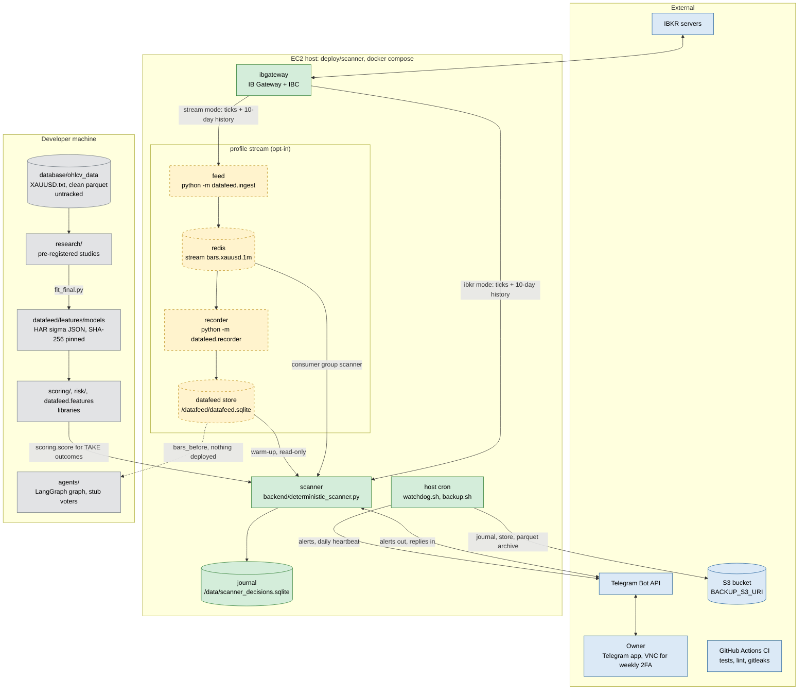
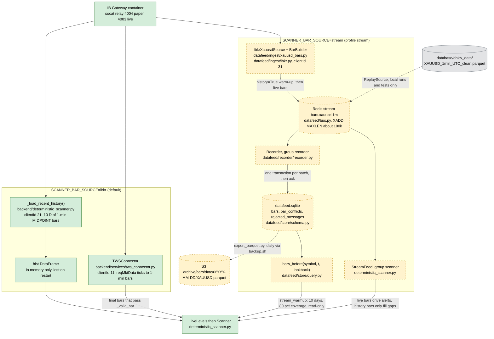
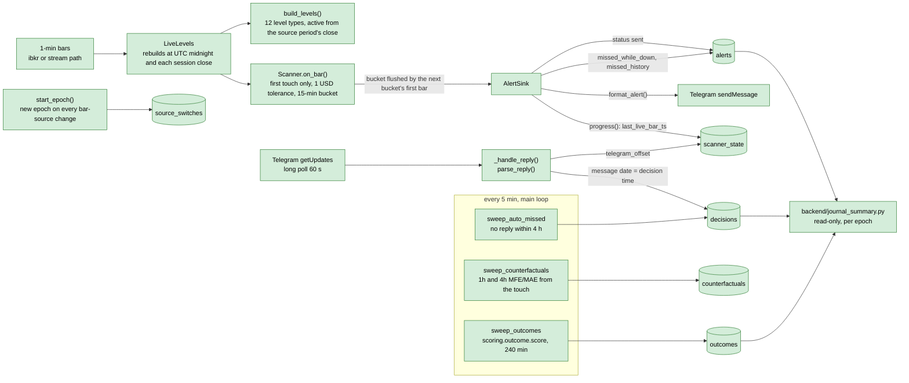
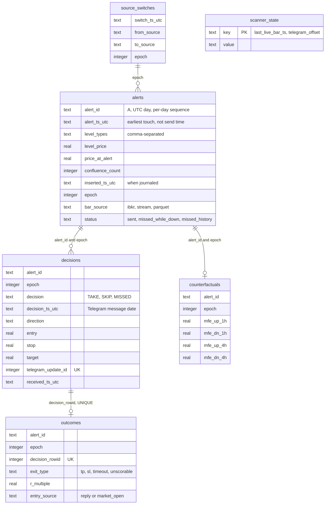
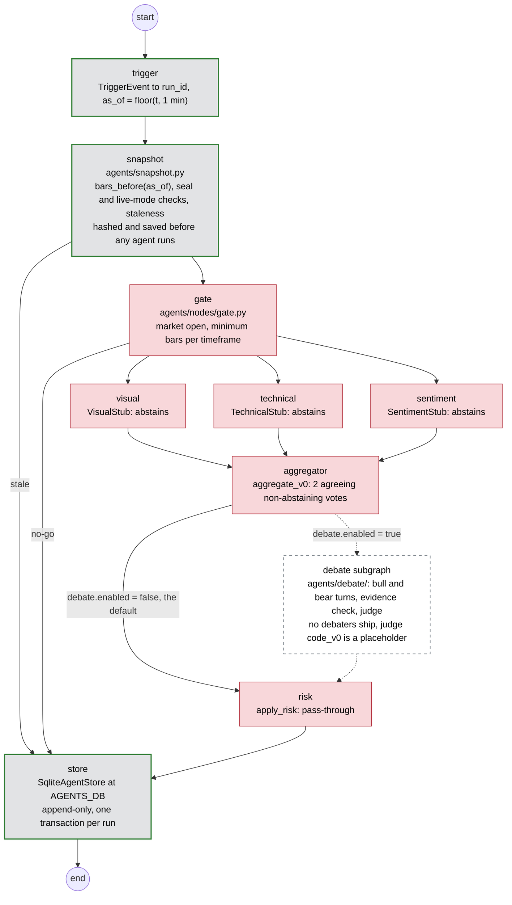
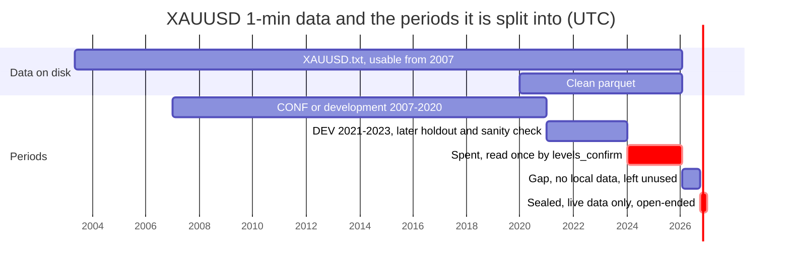
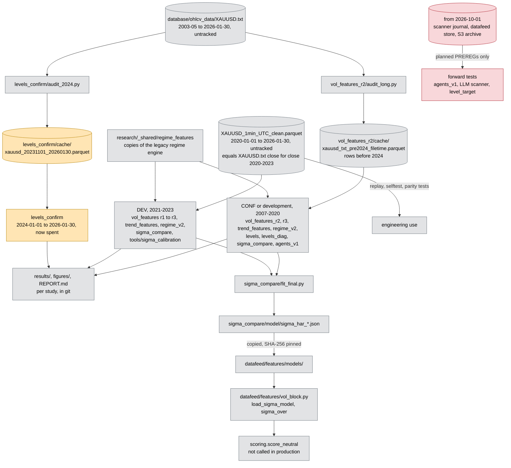
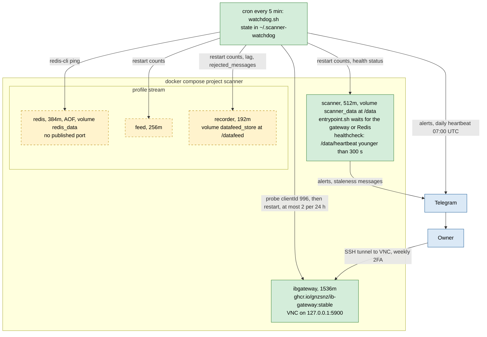
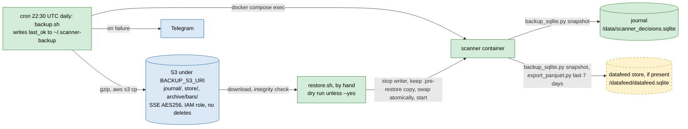

# Current architecture

Drawn from the code on `main` @ `d93803a` (2026-10-20), not from the design
docs. Work that exists only on unmerged branches is named as such.
`docs/ARCHITECTURE_MAP.md` and `docs/REPO_MAP.md` are surveys from before the
phase 1 cleanup and use old paths.

**What the EC2 host runs isn't recorded in git.** PR #18 (2026-10-18) states
that the host ran branch `pipeline-fixes-and-cleanup` (last commit
2026-09-29), not `main`. That branch has no journal migrations, no TAKE
scoring, no `backup.sh` and no stream mode. Everything below describes `main`,
so those parts may not be live yet. Check on the host with
`git -C ~/oparli status -sb`.

Legend used in the diagrams:

| Colour | Meaning |
|---|---|
| green | runs in the production stack (`deploy/scanner`, default profile) |
| yellow, dashed | built and deployable, opt-in (`COMPOSE_PROFILES=stream`) |
| grey | built, not deployed anywhere |
| red | stub or placeholder |
| blue | external service |

## (a) System overview

- The scanner is the only production service. It never trades and never
  calls an LLM.
- In `ibkr` mode (the default and the rollback), the scanner is a gateway
  client itself. In `stream` mode the feed is the gateway's only bar client,
  and the scanner reads Redis and the store.
- `scoring/` (and `risk/` through it) runs inside the scanner image. The rest
  of the developer-machine box isn't deployed.

## (b) Live data path, with files

- **Bar contract.** `bar_ts` is the minute's open time in UTC. The price is
  the bid/ask midpoint, and a minute without ticks has no bar.
  `datafeed/ingest/xauusd_bars.py` lists five approved differences from the
  connector's bar builder. `tests/datafeed/test_xauusd_bars.py` pins the two
  builders together.
- **As-of rule.** `bars_before(t)` returns bars with `bar_ts + 1 min <= t`.
  With `known_by` it also requires `ingest_ts <= known_by`.
- **Gateway client ids:** 11 and 21 (scanner, ibkr mode), 31 (feed), 996
  (watchdog probe), 999 (entrypoint wait).
- **Replay** bars are kind `replay` in the store. Readers get them only by
  asking for `kinds=("replay",)`. A replay window can't end after
  2026-10-01, or run past the parquet's coverage.

## (c) Scanner and journal

- **Schema version.** `PRAGMA user_version` is 4, and the journal migrates on
  first open (`_migrate_journal`). An image from before migration 1 can't
  write to a migrated journal.
- **Epochs.** Joins use `(alert_id, epoch)`, because alert ids repeat across
  epochs on a switch day. Analyses never pool epochs.
- **First decision counts.** Only the first decision per alert and epoch is
  scored and counted. Later replies are journaled as revisions.
- **Delivery delay.** An alert is sent when the first bar of the next 15-minute
  bucket arrives, so `alert_ts_utc` is earlier than the send time. Replay of
  2025: median 11 min, 7 of 1,706 alerts over an hour (the daily break), one
  across a weekend.
- **Not shown above:** the selftest (`--selftest`) and the `--date` replay
  (`replay_day`). `replay_day` starts each day with a fresh `Scanner`, so it
  can differ from a continuous run (`tests/scanner/test_parity.py`).

## (d) Agents graph: built vs stub

`agents/graph.py` on `main`. Nothing deployed runs it: no trigger
implementation and no entry point ship. Only `tests/agents_tests` drives it.
Grey with a thick border: built. Red: stub or placeholder. Dashed: off by
default.

| Node | State on `main` |
|---|---|
| trigger | built; the `Trigger` protocol and `drive()` exist, but no trigger does |
| snapshot | built: `as_of` floor, replay refused after 2026-10-01, live mode needs an experiment PREREG and a wall clock within 120 s |
| gate, aggregator | placeholder rules, "not to be tuned on results" |
| visual, technical, sentiment | stubs that always abstain |
| debate | built and tested, off by default; no real debaters, placeholder judge |
| risk | pass-through stub |
| store | built: SQLite, append-only (UPDATE and DELETE abort), one transaction per run |

**Unmerged branch `feat/agents-metrics` (4b78b29),** stacked on
`feat/agents-architecture`, `-prompt-config`, `-llm-client` and
`-discussion`, adds:
- LLM voters (technical, visual, sentiment, gex) built from owner-written
  prompts; a missing or `TEMPLATE` prompt means abstain;
- an Anthropic client with a response cache, a daily call budget, a kill
  switch, a ledger and cache-only rerun;
- a discussion subgraph that replaces the debate, plus Meta rules;
- the epoch hash, and σ features in the snapshot.

None of this is on `main`.

## (e) Research data flow, sealed and spent periods

Where the periods are enforced in code:

| Rule | Code | Covers |
|---|---|---|
| global seal, before 2026-10-01 | `research/sealing.py` `assert_before_global_seal` | levels_confirm, levels_diag, sigma_compare |
| study seal, before 2024-01-01 | `SEAL` in `vol_features/run_study.py`, `assert_sealed` in `run_r2.py` / `run_r3.py`, `levels/levels.py`, `audit_long.py` | studies before levels_confirm |
| replay window | `ReplaySource` in `datafeed/ingest/xauusd_bars.py`: end at or before `SEAL_START`, a row at or after it stops the run, window inside `PARQUET_COVERAGE` | datafeed replay, scanner parity tests |
| σ training window | `vol_block.fit` and `VolParams`: `train_end` at or before `SEAL_START` | σ fits |
| agents | `agents/snapshot.py` `check_access`: replay after the seal raises `SealedError`; live needs a PREREG file and a wall clock within 120 s | agent snapshots |
| none | `datafeed.store.query.bars_before`, the scanner journal, the S3 archive | live (post-seal) data |

- The spent period has no shared check: each later study's loader asserts
  dates before 2024-01-01.
- `SEAL_START` (datafeed) and `GLOBAL_SEAL` (research) are separate
  constants, and a test asserts they are equal.

## (f) Ops

The host is an EC2 instance with 3.8 GB RAM and a 2 GB swap file, with the
stack in `~/oparli/deploy/scanner`. Its `.env` (host only, never in git) holds
the TWS login, the Telegram token and chat id, `BACKUP_S3_URI` and
`COMPOSE_PROFILES`.

Runtime and monitoring:

Backup and restore:

**CI** (`.github/workflows/ci.yml`) runs on every push and PR: pytest with a
Redis service, the selftest when the parquet exists, ruff, shellcheck and
gitleaks. It has no deploy step. The parquet isn't in git, so on GitHub every
test that needs it, the selftest included, skips.

**Watchdog checks.** Thresholds are constants at the top of `watchdog.sh`.
- Gateway down for 2 checks: alert, then a gateway restart.
- Scanner restarted 3 or more times in 5 minutes.
- Scanner unhealthy for 2 checks: alert only.
- Feed or recorder crash loop; Redis not answering PING.
- Disk 85 % or more; MemAvailable under 10 %.
- Last backup over 26 hours old.
- Recorder lag of 15 or more market-open minutes, and any growth in
  `rejected_messages`.

Market alerts are quiet from Friday 17:00 to Sunday 17:00 New York. The
watchdog finds containers by their fixed names (`scanner-scanner-1` and so
on), so the compose project must be called `scanner`.

**Deploys** are manual (`docs/DEPLOY_RUNBOOK.md`). Rollback means setting
`SCANNER_BAR_SOURCE=ibkr`, never using an image from before the journal
migration.

## (g) Files and stores

| File or store | Lives in | Written by | Read by | Notes |
|---|---|---|---|---|
| `database/ohlcv_data/XAUUSD.txt` | developer machine, untracked | not recorded in git | `audit_long.py`, `audit_2024.py` (both cache it) | 1-min bars, 2003-05-06 to 2026-01-30; usable from 2007 (`research/vol_features/DATA_AUDIT_LONG.md`) |
| `database/ohlcv_data/XAUUSD_1min_UTC_clean.parquet` | developer machine, untracked | built from `XAUUSD.txt` (the script isn't in git) | scanner `--date` and `--selftest`, `ReplaySource`, research DEV (2021–2023), `tools/sigma_calibration`, parity, scoring and agents tests | 2020-01-01 23:00 to 2026-01-30 21:59 UTC (`PARQUET_COVERAGE`) |
| `research/vol_features_r2/cache/xauusd_txt_pre2024_filetime.parquet` | developer machine, gitignored | `research/vol_features_r2/audit_long.py` | the r2/r3 loaders, so: trend_features, regime_v2, levels, levels_diag, sigma_compare, agents_v1 | rows before 2024 |
| `research/levels_confirm/cache/xauusd_20231101_20260130.parquet` | developer machine, gitignored | `research/levels_confirm/audit_2024.py` | `research/levels_confirm/confirm.py` | spent period |
| `research/<study>/results/`, `figures/` | git | the study's run script | its `REPORT.md` | |
| `research/_shared/regime_features/` | git | copied from `legacy/regime_classifier` | vol_features r1–r3, trend_features, regime_v2 | byte-identical copies |
| `research/sigma_compare/model/sigma_har_*.json` | git | `research/sigma_compare/fit_final.py` | copied by hand to `datafeed/features/models/` | |
| `datafeed/features/models/sigma_har_*_v1.json` | git, package data | copy of the research model | `vol_block.load_sigma_model` (SHA-256 pinned in `SIGMA_MODELS`), then `scoring.score_neutral` | default `parquet2021_2023`; `DATAFEED_SIGMA_MODEL` overrides it |
| scanner journal `scanner_decisions.sqlite` | EC2 volume `scanner_data` at `/data/`; locally `database/` (`SCANNER_DB`) | `backend/deterministic_scanner.py`, the only writer; it migrates on open | `backend/journal_summary.py` (read-only), `backup_sqlite.py` via `backup.sh` | gitignored; daily copy to S3 `journal/` |
| `/data/heartbeat` | volume `scanner_data` | the scanner's main loop (`beat`) | compose healthcheck, which the watchdog reads through `docker inspect` | |
| `/data/.redis-wait-alerted` | volume `scanner_data` | `deploy/scanner/entrypoint.sh` | `entrypoint.sh` (hourly alert limit) | stream mode only |
| Redis stream `bars.xauusd.1m` | volume `redis_data` (AOF) | feed (`python -m datafeed.ingest`) | consumer groups `recorder` and `scanner` (`SCANNER_STREAM_GROUP`) | stream profile; about 100k entries kept |
| datafeed store `datafeed.sqlite` | volume `datafeed_store` at `/datafeed/`; locally `DATAFEED_DB` | `datafeed.recorder`, the only writer | scanner warm-up, `export_parquet.py`, `backup_sqlite.py`, watchdog store stats, `agents.snapshot`, `vol_block.read_state`, `scoring.read_bars` | WAL; tables `bars`, `bar_conflicts`, `rejected_messages` |
| S3 `journal/`, `store/` | S3 under `BACKUP_S3_URI` | `deploy/scanner/backup.sh` | `deploy/scanner/restore.sh` (by hand) | never deleted by scripts; retention by lifecycle rule |
| S3 `archive/bars/date=YYYY-MM-DD/XAUUSD.parquet` | S3 | `backup.sh` via `export_parquet.py` | nothing | post-seal data |
| `deploy/scanner/.env` | EC2 host only | owner | docker compose, `watchdog.sh` and `backup.sh` (`val()`) | never in git; `.env.example` is the template |
| `~/.scanner-watchdog`, `~/.scanner-backup` | EC2 host | `watchdog.sh`; `backup.sh` (`last_ok`) | `watchdog.sh` | state files |
| `~/scanner-watchdog.log`, `~/scanner-backup.log` | EC2 host | cron | owner | |
| agent store (`AGENTS_DB`) | wherever it's set; nothing deployed | `agents.store.sqlite` (snapshot and store nodes) | tests | append-only |
| `agents/experiments/<id>/PREREG.md` | git | owner | `agents.prereg.require_prereg` | none exists yet; checked on disk, not in git |
| `agents/config.example.toml` | git | | `AgentsConfig.from_toml` | |
| `agents/prompts/bull.md`, `bear.md` | git, package data | | nothing | templates for future debaters |
| `requirements.lock`, `requirements.cutoff.txt` | git | `pip-compile` | CI install, `tests/agents_tests/test_lock.py` | the Dockerfiles don't use the lock |
| `database/historical_news/*` | developer machine, untracked (`DATA_NOTES_events.md` in git) | `tools/scraper_fxfac/` | `legacy/` only | the LLM scanner design calls for a point-in-time calendar store; not built |
| `XAUUSD_COMPLETE.csv` | developer machine | `tools/data/fetch_data_xauusd.py` | nothing in the repo | IBKR MIDPOINT history |
| `GC_FUTURES_1MIN.csv`, `touch_events.parquet`, `tsmom_daily.parquet` | developer machine, untracked | `legacy/` | `legacy/` only | |

## Keeping this current

Each diagram comes from the module named in its labels. Recheck these files
when they change:
- (b): `datafeed/ingest`, `datafeed/bus.py`, `datafeed/recorder`,
  `datafeed/store`;
- (c): the journal section of `deterministic_scanner.py`;
- (d): `agents/graph.py`;
- (e): `research/README.md` and `research/SEALING.md`;
- (f): `deploy/scanner/`.

The Mermaid blocks were checked with `@mermaid-js/mermaid-cli` 11.4.2.
