# Current architecture

Drawn from the code on `main` @ `c556533` (2026-10-20), not from the design
docs. The open PR #22 (instrument config) isn't drawn.
`docs/ARCHITECTURE_MAP.md` and `docs/REPO_MAP.md` are surveys from before the
phase 1 cleanup and use old paths.

**What the EC2 host runs isn't recorded in git.** PR #18 (2026-10-18) states
that the host ran branch `pipeline-fixes-and-cleanup` (last commit
2026-09-29), not `main`. That branch has no journal migrations, no TAKE
scoring, no `backup.sh` and no stream mode. Everything below describes `main`,
so those parts may not be live yet. Check on the host with
`git -C ~/oparli status -sb`.

Legend used in the diagrams:

| Colour | Meaning |
|---|---|
| green | runs in the production stack (`deploy/scanner`, default profile) |
| yellow, dashed | built and deployable, opt-in (`COMPOSE_PROFILES=stream`) |
| grey | built, not deployed anywhere |
| red | stub or placeholder |
| blue | external service |

## (a) System overview

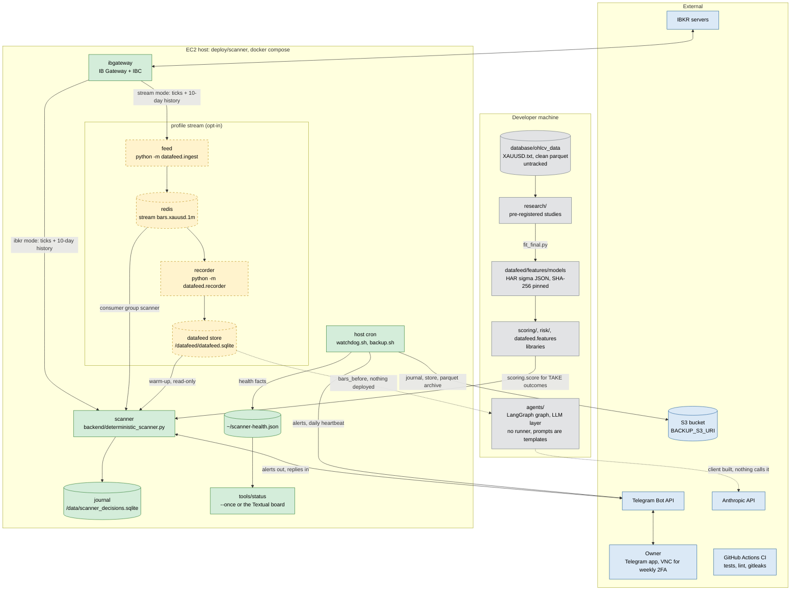

- The scanner is the only production service. It never trades and never
  calls an LLM.
- In `ibkr` mode (the default and the rollback), the scanner is a gateway
  client itself. In `stream` mode the feed is the gateway's only bar client,
  and the scanner reads Redis and the store.
- `scoring/` (and `risk/` through it) runs inside the scanner image. The rest
  of the developer-machine box isn't deployed.
- The status board reads only `health.json`, which the watchdog writes every
  run. `python3 -m tools.status --once` needs no packages; the Textual board
  needs the `status` extra.
- Nothing calls the Anthropic API. Outside the tests, only LangGraph Studio
  (`tools/langgraph_studio/studio.py`, a local replay-only debugging tool)
  builds the agents graph, and it passes no LLM client. The only command
  that makes a client is `python -m agents.llm count-tokens`.

## (b) Live data path, with files

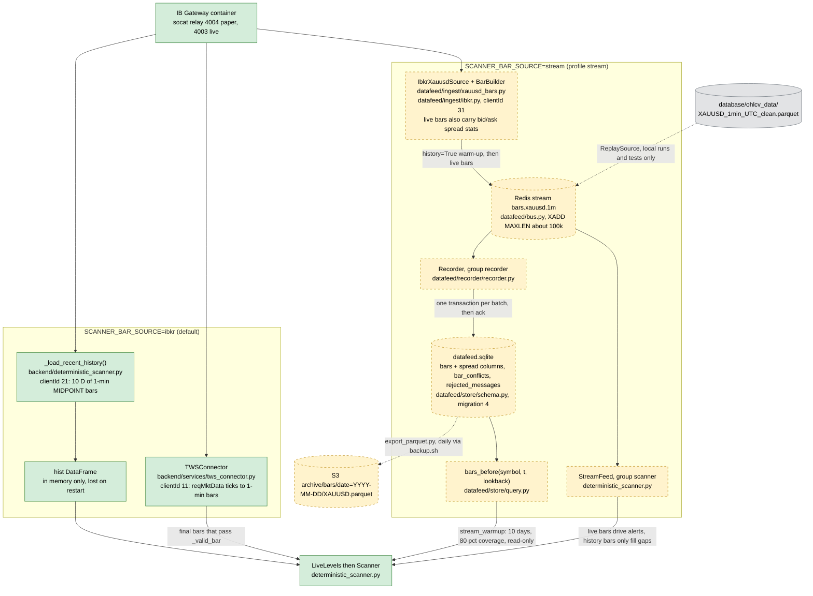

- **Bar contract.** `bar_ts` is the minute's open time in UTC. The price is
  the bid/ask midpoint, and a minute without ticks has no bar.
  `datafeed/ingest/xauusd_bars.py` lists five approved differences from the
  connector's bar builder. `tests/datafeed/test_xauusd_bars.py` pins the two
  builders together.
- **As-of rule.** `bars_before(t)` returns bars with `bar_ts + 1 min <= t`.
  With `known_by` it also requires `ingest_ts <= known_by`.
- **Spread (migration 4).** Live bars carry `spread_mean`, `spread_median`,
  `spread_max` (ask − bid, as quoted) and `n_quotes`, all four or none. They
  are NULL for history and replay bars, stay out of the duplicate/conflict
  comparison, and `bars_before` doesn't return them. They're read with
  `query.spreads()` or `tools/spread_by_hour.py` (read-only).
- **Gateway client ids:** 11 and 21 (scanner, ibkr mode), 31 (feed), 996
  (watchdog probe), 999 (entrypoint wait).
- **Replay** bars are kind `replay` in the store. Readers get them only by
  asking for `kinds=("replay",)`. A replay window can't end after
  2026-10-01, or run past the parquet's coverage.

## (c) Scanner and journal

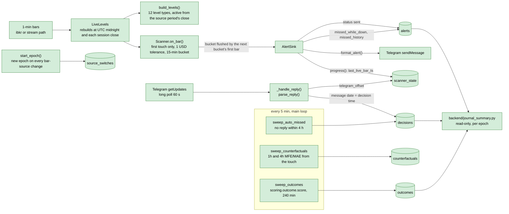

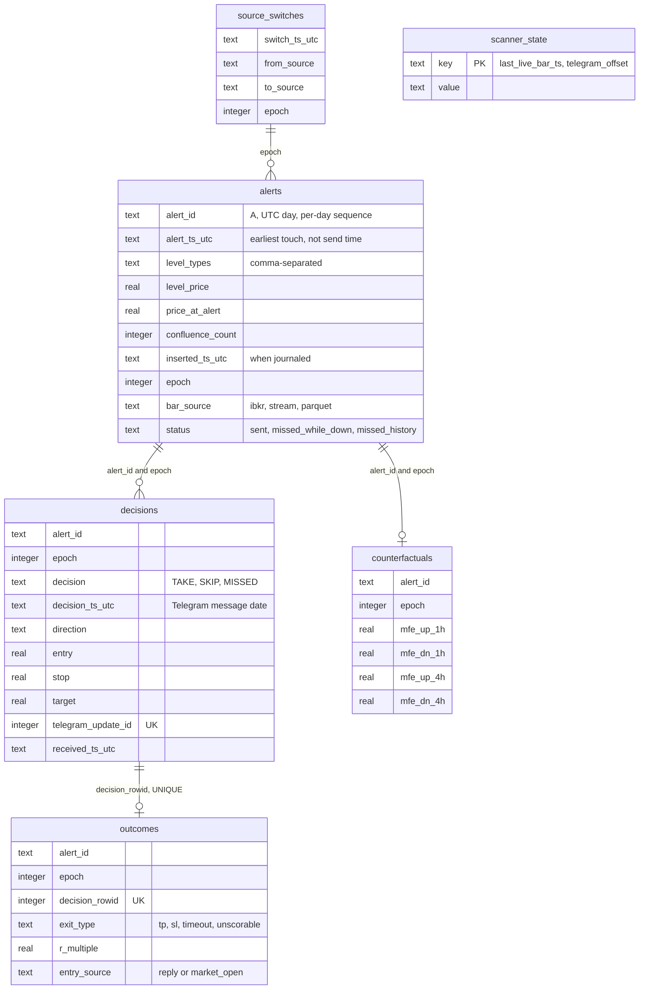

- **Schema version.** `PRAGMA user_version` is 4, and the journal migrates on
  first open (`_migrate_journal`). An image from before migration 1 can't
  write to a migrated journal.
- **Epochs.** Joins use `(alert_id, epoch)`, because alert ids repeat across
  epochs on a switch day. Analyses never pool epochs.
- **First decision counts.** Only the first decision per alert and epoch is
  scored and counted. Later replies are journaled as revisions.
- **Delivery delay.** An alert is sent when the first bar of the next 15-minute
  bucket arrives, so `alert_ts_utc` is earlier than the send time. Replay of
  2025: median 11 min, 7 of 1,706 alerts over an hour (the daily break), one
  across a weekend.
- **Not shown above:** the selftest (`--selftest`) and the `--date` replay
  (`replay_day`). `replay_day` starts each day with a fresh `Scanner`, so it
  can differ from a continuous run (`tests/scanner/test_parity.py`).

## (d) Agents (v2)

**Nothing deployed runs the agents graph.** There is no runner, no trigger
implementation and no deployed entry point. Outside the tests, the only caller
of `build_graph` is LangGraph Studio (`tools/langgraph_studio/`,
`docs/LANGGRAPH_STUDIO.md`): a laptop tool, replay data only, an in-memory
agent store and no LLM client. Every prompt in `agents/prompts/` is still the
unfilled template (`version: TEMPLATE`), so even with an LLM client every LLM
agent would abstain `prompt_invalid`. The status board reports agents as OFF.

Legend for (d1) and (d4):

| Style | Meaning |
|---|---|
| grey, thick border | built: real code, tested, runs on every graph run |
| red | stub or placeholder: fixed answer, or a placeholder rule |
| white, dashed | not running: built, but nothing in the default graph reaches it |
| black, dotted | not built |

### (d1) The run graph

`agents/graph.py` `build_graph`. Each node shows what it is in the default
graph, i.e. without an `llm_client`, which is how every caller on `main`
(the tests and Studio) builds it.

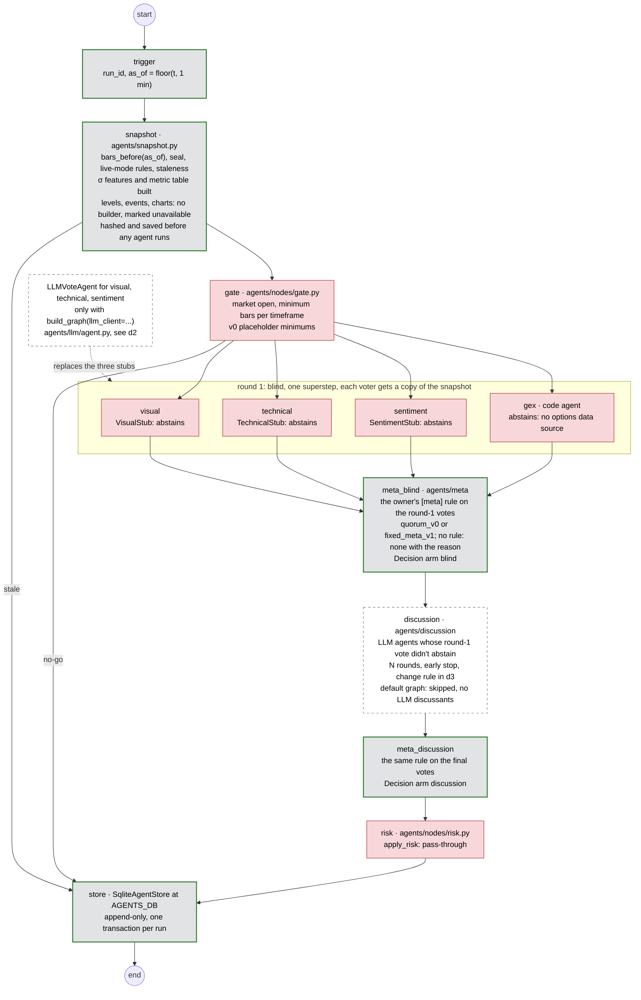

| Node | State on `main` |
|---|---|
| trigger | built. The `Trigger` protocol and `drive()` exist; no trigger does |
| snapshot | built: `as_of` floor, replay refused after 2026-10-01, live mode needs an experiment PREREG and a wall clock within 120 s. HAR σ (60/240) and L, S_hd, T from `agents/features.py`, with the σ model named in `snapshot.sigma_model` (SHA-256 checked). The metric table from `agents/technical/metrics.py`. Levels, events and charts have no builder |
| gate | real checks with v0 placeholder minimums (one bar per timeframe) |
| visual, technical, sentiment | stubs that abstain. With an `llm_client` they are LLM agents (d2), but nothing passes one |
| gex | code agent that always abstains (`no options data source`) |
| meta_blind, meta_discussion | built: `quorum_v0` and `fixed_meta_v1`. The owner picks one in `agents.toml`; there's no default rule. Rule name and version are on every decision |
| discussion | built and tested with fake discussants; never reached in the default graph, which has no discussants |
| risk | pass-through stub; entry, SL, TP, size and σ stay null |
| store | built: SQLite, append-only (UPDATE and DELETE abort), one transaction per run, migration 5 |
| technical_v1 | not built; see d4 |

Every decision is stamped with the epoch (`agents/epoch.py`): a SHA-256 over
the prompt files, the owner's `agents.toml`, the per-agent call settings, the
output schema, the input-building code, the Meta rule and the σ model. Any
change gives a new epoch automatically.

### (d2) One LLM agent's call path

`LLMVoteAgent.vote()` (`agents/llm/agent.py`) for visual, technical or
sentiment. Not running: nothing builds the graph with a client, and the
prompts are templates. Every exit on the right is an abstain with that reason;
nothing raises. The graph's `safe_vote` also bounds the whole call by
`node_timeout_s`.

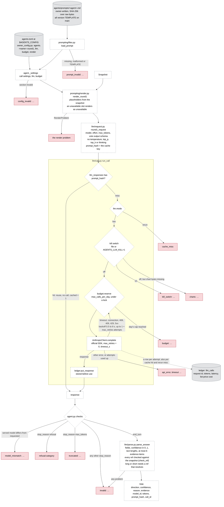

- **The cache** (`llm_responses`) and **the ledger** (`llm_calls`) live in
  the agent store (migration 4). A cached response is the stored copy, so a
  rerun reproduces it byte for byte.
- **The budget** counts sent attempts per UTC day, not cache hits.
- **A discussion call** (`discuss()`) is the same path with the agent's
  `discussion` call settings: its round-1 content again, then
  `discussion.md`. Any problem there becomes the change rule's
  `call failed: …` (d3), not an abstain.

### (d3) The discussion vote-change rule

`agents/discussion/rule.py` `apply_change_rule(previous, proposal, round)`,
applied to every discussant's proposal in every discussion round. Pure code,
tested; not running on `main` (see d1).

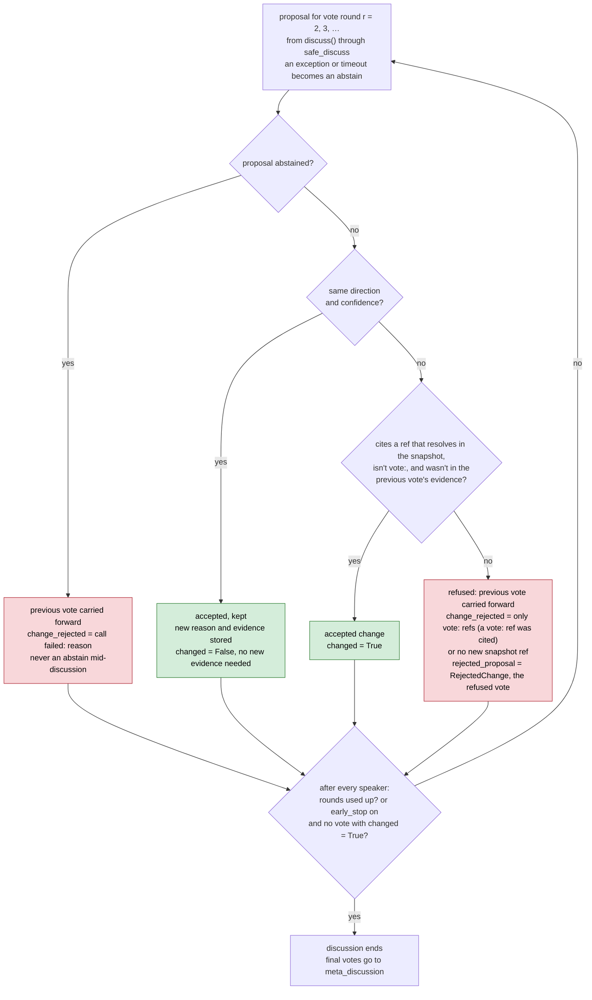

- **Who speaks:** discussants (agents with a `discuss` method, the LLM agents)
  whose round-1 vote didn't abstain. GEX, the stubs and abstainers keep their
  round-1 vote, which the speakers see.
- **Simultaneous rounds, content only:** in round r every speaker sees the
  others' latest votes from before the round, without model ids, prompt
  hashes, tokens or latency.
- **Skip reasons**, the most basic first: no LLM discussants in the graph,
  an invalid `[discussion]` config, an invalid `discussion.md`, every
  discussant abstained in round 1. A skipped discussion is still a
  `discussions` row (`rounds_run = 0`), and both decisions are stored.
- Every carried or refused vote keeps that round's call provenance (model,
  prompt hash, tokens, call id).

### (d4) Where Technical v1 will sit

The deterministic Technical agent of agents v1 (`research/agents_v1/PREREG.md`,
DRAFT) is planned as its own arm, outside Meta. On `main` only its slots
exist.

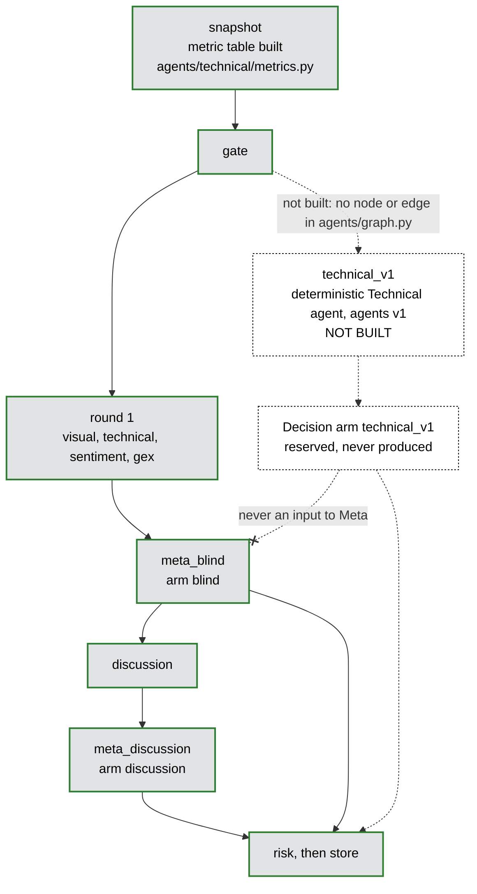

| Slot for technical_v1 | Where | State |
|---|---|---|
| the agent | none | not built |
| its graph node and edges | `agents/graph.py` | not built |
| the arm `technical_v1` | `Arm` in `agents/schemas.py`, `ARM_ORDER` in `graph.py`, the `decisions.arm` CHECK (store migration 5) | reserved |
| on/off switch | `[agents.technical_v1] enabled` in `agents.example.toml`, `CODE_AGENTS` in `owner_config.py` | reserved |
| its input | `snapshot.metrics` through `metric(rows, name)`, the same table the Technical-LLM reads as `{{metrics_table}}` | built |
| its PREREG | `research/agents_v1/PREREG.md`: H = 240 primary | DRAFT |

## (e) Research data flow, sealed and spent periods

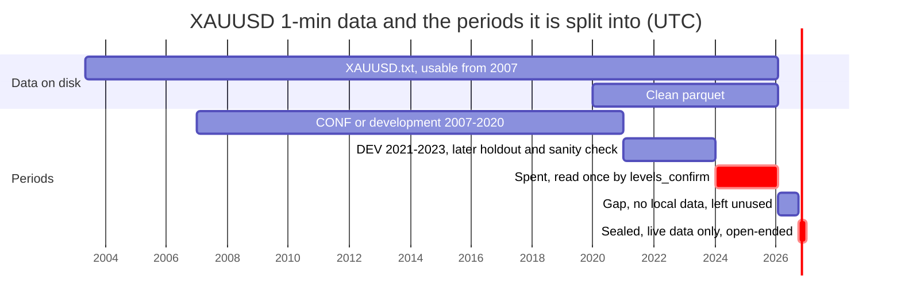

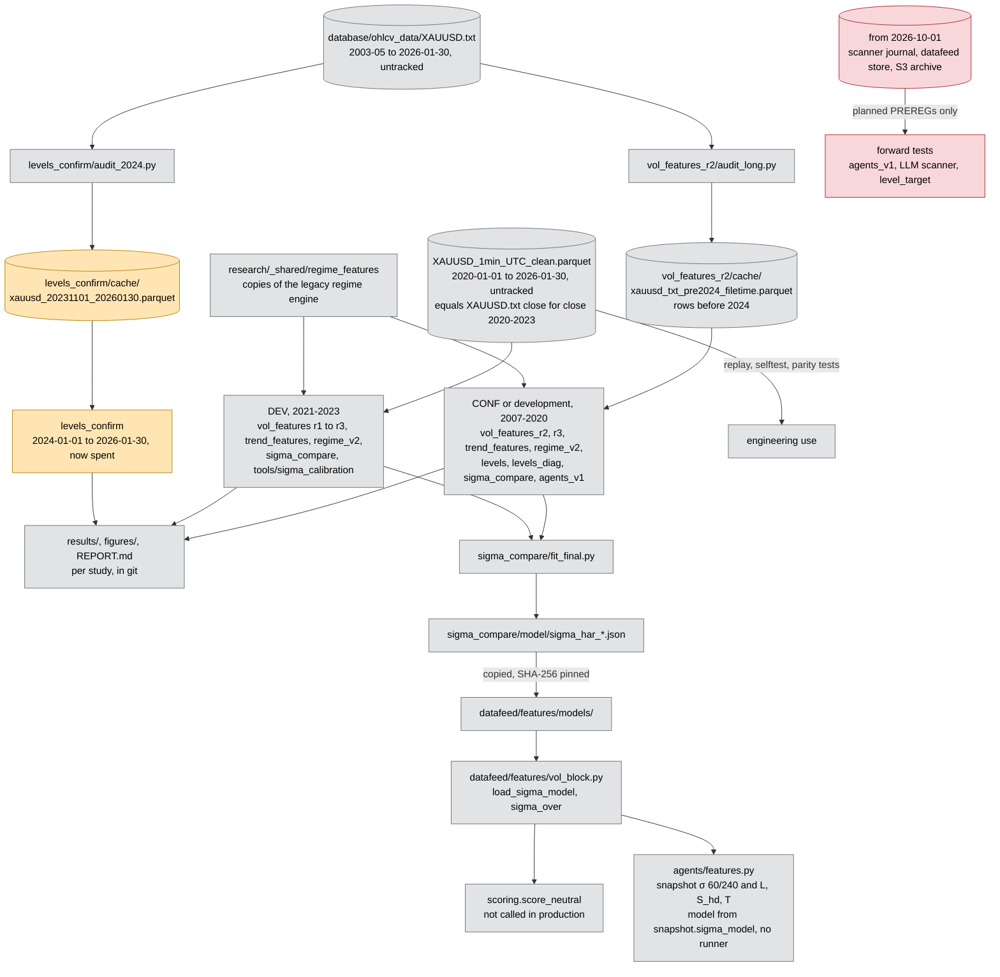

Where the periods are enforced in code:

| Rule | Code | Covers |
|---|---|---|
| global seal, before 2026-10-01 | `research/sealing.py` `assert_before_global_seal` | levels_confirm, levels_diag, sigma_compare |
| study seal, before 2024-01-01 | `SEAL` in `vol_features/run_study.py`, `assert_sealed` in `run_r2.py` / `run_r3.py`, `levels/levels.py`, `audit_long.py` | studies before levels_confirm |
| replay window | `ReplaySource` in `datafeed/ingest/xauusd_bars.py`: end at or before `SEAL_START`, a row at or after it stops the run, window inside `PARQUET_COVERAGE` | datafeed replay, scanner parity tests |
| σ training window | `vol_block.fit` and `VolParams`: `train_end` at or before `SEAL_START` | σ fits |
| agents | `agents/snapshot.py` `check_access`: replay after the seal raises `SealedError`; live needs a PREREG file and a wall clock within 120 s | agent snapshots |
| none | `datafeed.store.query.bars_before`, the scanner journal, the S3 archive | live (post-seal) data |

- The spent period has no shared check: each later study's loader asserts
  dates before 2024-01-01.
- `SEAL_START` (datafeed) and `GLOBAL_SEAL` (research) are separate
  constants, and a test asserts they are equal.

## (f) Ops

The host is an EC2 instance with 3.8 GB RAM and a 2 GB swap file, with the
stack in `~/oparli/deploy/scanner`. Its `.env` (host only, never in git) holds
the TWS login, the Telegram token and chat id, `BACKUP_S3_URI` and
`COMPOSE_PROFILES`.

Runtime and monitoring:

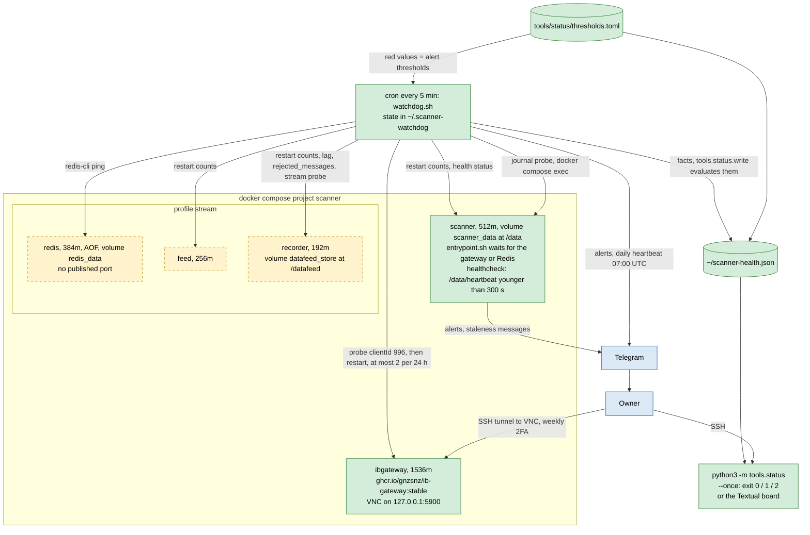

Backup and restore:

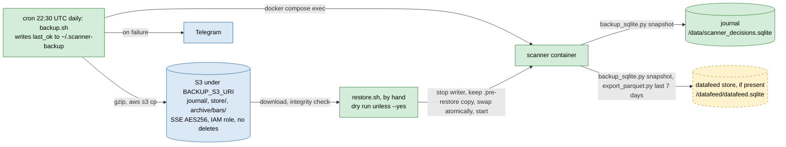

**CI** (`.github/workflows/ci.yml`) runs on every push and PR: pytest with a
Redis service, the selftest when the parquet exists, ruff, shellcheck and
gitleaks. It has no deploy step. The parquet isn't in git, so on GitHub every
test that needs it, the selftest included, skips.

**Watchdog checks.** The alert thresholds are the `red` values in
`tools/status/thresholds.toml`. `watchdog.sh` keeps the same numbers as a
fallback if the file can't be read, and `test_status_config.py` keeps the two
equal.
- Gateway down for 2 checks: alert, then a gateway restart.
- Scanner restarted 3 or more times in 5 minutes.
- Scanner unhealthy for 2 checks: alert only.
- Feed or recorder crash loop; Redis not answering PING.
- Disk 85 % or more; MemAvailable under 10 %.
- Last backup over 26 hours old.
- Recorder lag of 15 or more market-open minutes, and any growth in
  `rejected_messages`.

Market alerts are quiet from Friday 17:00 to Sunday 17:00 New York. The
watchdog finds containers by their fixed names (`scanner-scanner-1` and so
on), so the compose project must be called `scanner`.

**Status board** (`tools/status`). Every watchdog run also writes
`~/scanner-health.json`: green, yellow or red for ten components (gateway,
feed, redis, recorder, scanner, journal, backups, disk, memory, agents), each
with its reason. A fact the watchdog couldn't measure is red, never green.
Components outside the deployment show OFF: Redis and the recorder without
the stream profile, and agents always, for now. A `health.json` older than
15 minutes turns every component red.

**Deploys** are manual (`docs/DEPLOY_RUNBOOK.md`). Rollback means setting
`SCANNER_BAR_SOURCE=ibkr`, never using an image from before the journal
migration.

## (g) Files and stores

| File or store | Lives in | Written by | Read by | Notes |
|---|---|---|---|---|
| `database/ohlcv_data/XAUUSD.txt` | developer machine, untracked | not recorded in git | `audit_long.py`, `audit_2024.py` (both cache it) | 1-min bars, 2003-05-06 to 2026-01-30; usable from 2007 (`research/vol_features/DATA_AUDIT_LONG.md`) |
| `database/ohlcv_data/XAUUSD_1min_UTC_clean.parquet` | developer machine, untracked | built from `XAUUSD.txt` (the script isn't in git) | scanner `--date` and `--selftest`, `ReplaySource`, research DEV (2021–2023), `tools/sigma_calibration`, parity, scoring and agents tests | 2020-01-01 23:00 to 2026-01-30 21:59 UTC (`PARQUET_COVERAGE`) |
| `research/vol_features_r2/cache/xauusd_txt_pre2024_filetime.parquet` | developer machine, gitignored | `research/vol_features_r2/audit_long.py` | the r2/r3 loaders, so: trend_features, regime_v2, levels, levels_diag, sigma_compare, agents_v1 | rows before 2024 |
| `research/levels_confirm/cache/xauusd_20231101_20260130.parquet` | developer machine, gitignored | `research/levels_confirm/audit_2024.py` | `research/levels_confirm/confirm.py` | spent period |
| `research/<study>/results/`, `figures/` | git | the study's run script | its `REPORT.md` | |
| `research/_shared/regime_features/` | git | copied from `legacy/regime_classifier` | vol_features r1–r3, trend_features, regime_v2 | byte-identical copies |
| `research/sigma_compare/model/sigma_har_*.json` | git | `research/sigma_compare/fit_final.py` | copied by hand to `datafeed/features/models/` | |
| `datafeed/features/models/sigma_har_*_v1.json` | git, package data | copy of the research model | `vol_block.load_sigma_model` (SHA-256 pinned in `SIGMA_MODELS`), then `scoring.score_neutral` and `agents.features` | default `parquet2021_2023`; `DATAFEED_SIGMA_MODEL` overrides it. The agents name theirs in `snapshot.sigma_model`, with no default in code |
| scanner journal `scanner_decisions.sqlite` | EC2 volume `scanner_data` at `/data/`; locally `database/` (`SCANNER_DB`) | `backend/deterministic_scanner.py`, the only writer; it migrates on open | `backend/journal_summary.py` (read-only), `backup_sqlite.py` via `backup.sh`, `tools/status/probes/journal_stats.py` (read-only, run by the watchdog inside the container) | gitignored; daily copy to S3 `journal/` |
| `/data/heartbeat` | volume `scanner_data` | the scanner's main loop (`beat`) | compose healthcheck, which the watchdog reads through `docker inspect` | |
| `/data/.redis-wait-alerted` | volume `scanner_data` | `deploy/scanner/entrypoint.sh` | `entrypoint.sh` (hourly alert limit) | stream mode only |
| Redis stream `bars.xauusd.1m` | volume `redis_data` (AOF) | feed (`python -m datafeed.ingest`) | consumer groups `recorder` and `scanner` (`SCANNER_STREAM_GROUP`); `tools/status/probes/stream_stats.py` (newest live entry, run by the watchdog) | stream profile; about 100k entries kept |
| datafeed store `datafeed.sqlite` | volume `datafeed_store` at `/datafeed/`; locally `DATAFEED_DB` | `datafeed.recorder`, the only writer | scanner warm-up, `export_parquet.py`, `backup_sqlite.py`, watchdog store stats, `agents.snapshot`, `vol_block.read_state`, `scoring.read_bars`; spreads: `query.spreads`, `tools/spread_by_hour.py` (read-only) | WAL; tables `bars` (with the spread columns since migration 4), `bar_conflicts`, `rejected_messages` |
| S3 `journal/`, `store/` | S3 under `BACKUP_S3_URI` | `deploy/scanner/backup.sh` | `deploy/scanner/restore.sh` (by hand) | never deleted by scripts; retention by lifecycle rule |
| S3 `archive/bars/date=YYYY-MM-DD/XAUUSD.parquet` | S3 | `backup.sh` via `export_parquet.py` | nothing | post-seal data |
| `deploy/scanner/.env` | EC2 host only | owner | docker compose, `watchdog.sh` and `backup.sh` (`val()`) | never in git; `.env.example` is the template |
| `~/.scanner-watchdog`, `~/.scanner-backup` | EC2 host | `watchdog.sh`; `backup.sh` (`last_ok`) | `watchdog.sh` | state files |
| `~/scanner-watchdog.log`, `~/scanner-backup.log` | EC2 host | cron | owner | |
| `~/scanner-health.json` (`HEALTH_JSON`) | EC2 host | `watchdog.sh` through `python3 -m tools.status.write` (atomic write) | `python3 -m tools.status` (`--once` or the board) | 10 components; stale after 15 min |
| `tools/status/thresholds.toml` | git | owner | `tools.status` (evaluate), `watchdog.sh` (its alert thresholds = the `red` values) | the one place thresholds are set |
| `tools/status/requirements-status.lock` | git | copied verbatim from `requirements.lock` | `pip` on the host, for the Textual board | `test_status_lock.py` checks it is a subset |
| agent store (`AGENTS_DB`) | wherever it's set; nothing deployed | `agents.store.sqlite` (snapshot and store nodes) and the LLM ledger (`agents/llm/ledger.py`) | tests, `python -m agents.epoch --db` | append-only, migration 5: `snapshots`, `runs`, `votes`, `decisions`, `discussions`, `llm_calls`, `llm_responses` (the cache); `debate_turns` is history, no longer written |
| owner config `agents.toml` | outside the repo, at `$AGENTS_CONFIG`; template `agents/agents.example.toml` | owner; code never writes it | `agents.owner_config.OwnerConfig`: models, effort, max_tokens per agent and round, discussion, Meta rule, LLM, budget, render | not in git. Without it Meta has no rule (both decisions `none`), and an LLM agent would abstain `config_invalid`. Its SHA-256 enters the epoch |
| `agents/prompts/visual.md`, `technical.md`, `sentiment.md`, `gex.md`, `discussion.md` | git, package data | owner | `agents.prompting.files.load_all` | all `version: TEMPLATE`, so refused; `gex.md` is reserved (GEX is code and doesn't read it) |
| kill switch | `budget.kill_switch_path` in `agents.toml`, or `AGENTS_LLM_KILL=1` | owner | `agents/llm/budget.py`, before every live call | while present, LLM agents abstain `kill_switch` |
| `agents/experiments/<id>/PREREG.md` | git | owner | `agents.prereg.require_prereg` | none exists yet; checked on disk, not in git |
| `langgraph.json`, `requirements-studio.lock` | git | `uv pip compile` (the lock) | `langgraph dev` in a separate `.venv-studio` (`tools/langgraph_studio/studio.py:make_graph`) | local Studio only; replay data, in-memory agent store, empty `env`; `.langgraph_api/` is gitignored. The lock holds every project pin unchanged (tested) |
| `agents/config.example.toml` | git | | `AgentsConfig.from_toml` | snapshot (incl. `sigma_model`), gate, `node_timeout_s` |
| `agents/prompts/bull.md`, `bear.md` | git, package data | | nothing | the old debate prompts, unused since the discussion replaced the debate |
| `requirements.lock`, `requirements.cutoff.txt` | git | `pip-compile` | CI install, `tests/agents_tests/test_lock.py` | extras `llm` (anthropic) and `status` (textual) included; the Dockerfiles don't use the lock |
| `database/historical_news/*` | developer machine, untracked (`DATA_NOTES_events.md` in git) | `tools/scraper_fxfac/` | `legacy/` only | the LLM scanner design calls for a point-in-time calendar store; not built |
| `XAUUSD_COMPLETE.csv` | developer machine | `tools/data/fetch_data_xauusd.py` | nothing in the repo | IBKR MIDPOINT history |
| `GC_FUTURES_1MIN.csv`, `touch_events.parquet`, `tsmom_daily.parquet` | developer machine, untracked | `legacy/` | `legacy/` only | |

## Keeping this current

Each diagram comes from the module named in its labels. Recheck these files
when they change:
- (b): `datafeed/ingest`, `datafeed/bus.py`, `datafeed/recorder`,
  `datafeed/store`;
- (c): the journal section of `deterministic_scanner.py`;
- (d1): `agents/graph.py`, `agents/voters/`, `agents/meta/`, `agents/snapshot.py`;
- (d2): `agents/llm/` (`agent.py`, `call.py`, `budget.py`, `parse.py`),
  `agents/prompting/`, `agents/owner_config.py`;
- (d3): `agents/discussion/` (`rule.py`, `subgraph.py`, `node.py`);
- (d4): `Arm` in `agents/schemas.py`, `research/agents_v1/PREREG.md`;
- (e): `research/README.md` and `research/SEALING.md`;
- (f): `deploy/scanner/`, `tools/status/`.

The Mermaid blocks were checked with `@mermaid-js/mermaid-cli` 11.4.2.
