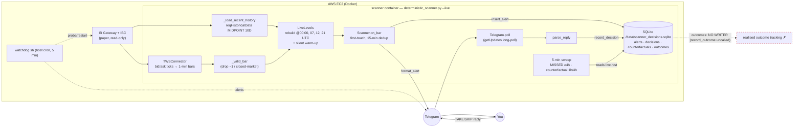
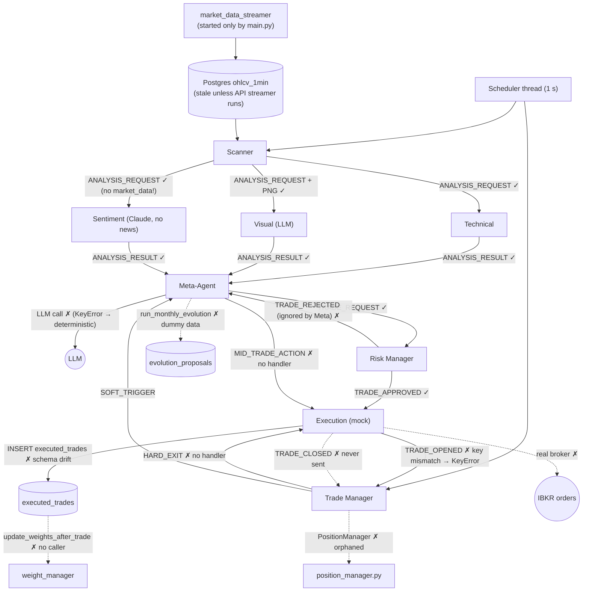
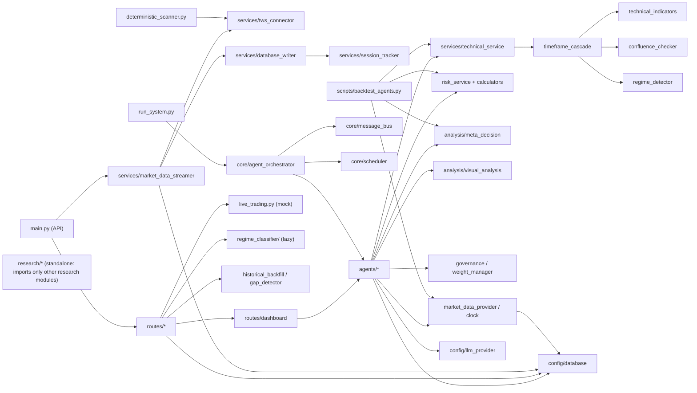

# OPARLI — Architecture Map

*Generated 2026-10-11. Read-only survey of branch `research/levels-diag` (commit `29dec96`), which contains every commit of `pipeline-fixes-and-cleanup` (the branch EC2 deploys). The scanner code and `deploy/scanner/` are byte-identical between the two. `main` is 48 commits behind and holds only the initial public release. Server state comes from the repo plus the owner's local notes dated 2026-09-27..29. I did not log into any server, so "deployed" means "configured to deploy / last known running", not "verified running today".*

> The repo is public. This document deliberately leaves out hostnames, IPs, key paths and secret values.

---

## 0. Summary

**What runs in production today.** Only the deterministic level scanner (`backend/deterministic_scanner.py`). It runs as a two-container Docker stack (IB Gateway + scanner) on one AWS EC2 t3.small, alongside a host-cron watchdog. It turns IBKR spot-gold midpoint ticks into 1-min bars and alerts Telegram when price first touches one of 12 level types. Your `TAKE`/`SKIP` replies go into an append-only SQLite journal, and counterfactual 1h/4h MFE/MAE are filled in later. It uses no LLM, no Postgres and no agents.

**What the agent framework does.** It does nothing in production. `backend/run_system.py` can start 8 agents on a message bus. Scan → 3 analysts → Meta → Risk works and is tested. The chain breaks after Risk:
- Execution's insert into `executed_trades` fails (schema drift).
- Trade Manager raises a KeyError on the `TRADE_OPENED` payload.
- `HARD_EXIT` and `MID_TRADE_ACTION` have no handler.
- Nothing ever emits `TRADE_CLOSED`.

The Meta-Agent's LLM is never actually called, because its prompt template raises a `KeyError` and the code falls back to deterministic rules. Execution is a mock (the default broker name is "OANDA").

**What's unfinished.**
- Realised outcome tracking for TAKEs: `record_outcome()` exists but has no caller.
- The GEX module: absent from every branch; only a COMEX-data probe is documented in local notes.
- The Sentiment news feed.
- Meta evolution, which runs on hard-coded dummy stats.
- Weight learning, which has no caller.
- Retiring `regime_detector`.
- Clock injection: `SimulatedClock` has no call sites.

**5 biggest risks / gaps (ranked)**

1. **The live path has no outcome leg.** For TAKEs, the journal records entry/SL/TP but never the result (`outcomes` table never written). Reply timestamps are processing time, not message time. After a crash, Telegram can re-deliver a reply, and nothing de-duplicates it. Today the TAKE-vs-SKIP experiment can only be scored on direction-agnostic counterfactual MFE/MAE.
2. **Production is a single, fragile host.** It is one small EC2 instance with no Elastic IP, and the gateway restarts daily. A 19.5h silent outage already happened (2026-09-28). The fix is a host-cron watchdog that lives outside version-controlled infra (it's installed into crontab by hand). No other monitoring exists, and the journal has no backup policy.
3. **Research levels ≠ scanner levels.** `research/levels*` defines PDH/PDL on a New York 17:00→17:00 trading day. The scanner uses UTC calendar days and ISO weeks, which put Sunday-evening bars into the *previous* week. A third set of session hours (`services/session_tracker.py`) disagrees with both. Research verdicts about "PDH/PDL" don't transfer 1:1 to what the scanner alerts on.
4. **The agent framework looks complete but cannot complete a trade.** See Summary §2 and §4.2. The tests stop exactly at the Risk Manager, so the broken downstream half is untested. Two more orchestration paths (`/api/dashboard/analyze`, `scripts/backtest_agents.py`) bypass the bus and governance, and they use **different default weights** from live (technical 0.50 vs 0.40).
5. **Look-ahead and clock leakage in agent backtests.**
   - LLM-backed backtest modes (`--with-visual`, the notebook) ask a model whose training data may post-date the bar about historical charts.
   - Prompts are stamped with the real `datetime.now()`.
   - `LiveDataProvider` bounds with `<= as_of` while `HistoricalDataProvider` uses `< as_of`.
   - Scanner Stage 1 and `ChartGenerator` read Postgres with no `as_of`.

*Also notable:*
- **Public-repo hygiene.** `scripts/deploy.sh` hard-codes a server IP and SSH key path.
- **Weak API auth.** The API key is shipped in the frontend bundle (`VITE_API_KEY`), so the API-key middleware is not real protection. `auth_routes.py` falls back to a hard-coded default dashboard password if `DASHBOARD_PASSWORD` is unset.
- **Stale market data.** Postgres `ohlcv_1min` data is stale (last backfill 2026-01-30 per notes), and only the API process ingests new bars.

---

## 1. Inventory

### 1.1 Top-level layout

| Path | Contents |
|---|---|
| `backend/` | Python: FastAPI app (`main.py`), agent runtime (`run_system.py`, `core/`, `agents/`), services, routes, SQL schemas, **and the deterministic scanner** (`deterministic_scanner.py`) |
| `backend/agents/` | 9 agent modules plus `base_agent.py` (Message/AgentType enums, BaseAgent, and a second, unused `AgentOrchestrator`) |
| `backend/core/` | `agent_orchestrator.py`, `message_bus.py`, `scheduler.py` |
| `backend/services/` | ~32 service modules: market data, indicators, risk calculators, IBKR connector, ingestion, etc. `services/analysis/` holds "pure" shared logic |
| `backend/routes/` | 7 FastAPI routers |
| `backend/config/` | `database.py` (psycopg2 pool from `DATABASE_URL`), `llm_provider.py` (Gemini/Claude factory), `news_events.py` (unused) |
| `backend/database/` | Agent/meta/risk/evolution SQL schemas |
| `backend/middleware/` | API-key, rate-limit, security-header middleware and input validators |
| `backend/static/` | `sweep_backtest_results.json`, pre-computed results served by `/api/backtest` |
| `database/` | `schema.sql` (OHLCV tables, views, materialized views), `historical_news/` notes. `ohlcv_data/` is an untracked symlink to the main checkout's data (parquet/CSV) |
| `deploy/scanner/` | Docker stack for the scanner: `Dockerfile`, `docker-compose.yml`, `entrypoint.sh`, `watchdog.sh`, `.env.example` |
| `frontend/` | Vue 3 + Vite dashboard: chart, agent-pipeline view, backtest view, live-trading UI. Includes a `Dockerfile` (dev/build only) |
| `notebooks/` | `backtest.ipynb` (origin of the scanner's level engine), `multi_agent_simulation.ipynb`, `smc_validation_backtest.ipynb`. None used operationally |
| `regime_classifier/` | Jump-model regime classifier + validator + tests. Separate dependency set (`joblib`, `scikit-learn`, `jumpmodels`) |
| `research/` | Pre-registered studies (vol_features r1–r3, vol_block, trend_features, regime_v2, levels, levels_confirm, levels_diag) and `sealing.py` (data seal ≥ 2026-10-01) |
| `scripts/` | Backtests and validations (SMC, ORB, sweeps, regime), `backtest_agents.py`, `backfill/` (IBKR/CSV → Postgres), shell launchers, `deploy.sh`, Oracle setup |
| `scripts/no_go_strategies/` | Archived SMC backtests (FVG, order blocks, regime) |
| `scraper_fxfac/` | Forex Factory calendar scraper (→ CSV). Its output feeds research notes, not code |
| `tests/` | `test_pipeline_integration.py`, `test_meta_renormalization.py`, `conftest.py` |

### 1.2 Entry points

| Entry point | Command | Starts | Deployed? |
|---|---|---|---|
| **Deterministic scanner (live)** | `python deterministic_scanner.py --live` (via `deploy/scanner/entrypoint.sh`) | IBKR feed → levels → Telegram alerts; Telegram reply poller; 5-min MISSED/counterfactual sweep | **Yes.** EC2, `docker compose up -d` in `deploy/scanner`, branch `pipeline-fixes-and-cleanup`, `restart: unless-stopped` |
| IB Gateway | `ghcr.io/gnzsnz/ib-gateway:stable` service in the same compose file | Headless IB Gateway + IBC (paper, read-only API, daily restart 17:15 ET, Sunday cold restart) | **Yes**, same stack |
| Scanner watchdog | `*/5 * * * * deploy/scanner/watchdog.sh` (host crontab, installed by hand) | API-handshake probe; Telegram alert; gateway re-login (≤2/24h); crash-loop alert | **Yes** per notes (cron line isn't version-controlled) |
| Scanner other modes | `--date YYYY-MM-DD` (replay from parquet), `--dry-live` (terminal only), `--selftest` | — | Local only |
| FastAPI app | `uvicorn main:app` (port 8001); `scripts/3-start-backend.sh`; `scripts/start-all.sh` (macOS Terminal) | REST + WebSocket, APScheduler (materialized-view refresh every 5 min), **market-data streamer auto-start (TWS → Postgres)** | **Ambiguous.** `scripts/deploy.sh` rsyncs backend + built frontend to a separate server and restarts a systemd unit `oparli-api`. The unit file isn't in the repo. Local notes (2026-09-27) say "the broader OPARLI agent system is not deployed". Current state unverified |
| Agent runtime | `python backend/run_system.py` | Orchestrator, scheduler thread (Scanner + Trade Manager every 1 s), main-thread loop draining on-demand mailboxes every 0.1 s | **No.** No Dockerfile/systemd/cron references it |
| Frontend | `npm run dev` / `npm run build` (`scripts/4-start-frontend.sh`, `frontend/Dockerfile`) | Vue dashboard | Built and rsynced by `deploy.sh` to an nginx root (ambiguous, as for the API) |
| Agent backtest | `python scripts/backtest_agents.py --start … --end …` | Replays services (not agents/bus) over `XAUUSD_COMPLETE.csv` | Research only |
| Other scripts | `scripts/smc_*.py`, `regime_strategy_backtest.py`, `run_walk_forward.py`, `asian_london_regression.py`, `analyze_backtest.py`, `visualize_sweep_trades.py`, `demo_backtestable_technical.py`, `backfill/*.py` | Offline research / data loading | No |
| Research studies | `research/*/run_*.py`, `levels.py`, `confirm.py`, `diag.py` | Pre-registered studies | No |
| Host setup | `scripts/setup-oracle-cloud.sh`, `scripts/connect.sh` | Postgres install + schema on an Oracle host; SSH tunnel + `/api/streaming/start` | Legacy (Oracle target, superseded) |

There is no CI (`.github/` doesn't exist), no Makefile/Procfile, and no tracked systemd units.

### 1.3 External services

| Service | Used by | Details |
|---|---|---|
| **IBKR (TWS / IB Gateway)** | Scanner (`services/tws_connector.py`, `ib_insync`); API streamer & backfill | Scanner: CMDTY XAUUSD SMART/USD, MIDPOINT history (10 days) + bid/ask ticks → 1-min bars, `readonly=True`. Ports are inconsistent across code: scanner default 7497, streamer/backfill hard-coded 4002, docker 4004 (paper socat relay), `.env.example` 4002 |
| **Telegram Bot API** | Scanner (`urllib`), watchdog (`curl`) | `sendMessage` + `getUpdates` long-poll. Token/chat id from env. Only one process may poll the bot |
| **LLM APIs** | Visual Analyst, Meta-Agent, Sentiment Analyst, Meta strategist (dead) | `config/llm_provider.py`: `LLM_PROVIDER` = `gemini` (default when `ENV≠production`, model `gemini-2.5-pro`) or `claude` (production default, `claude-sonnet-4-20250514`). `LLM_MODEL` overrides. **Sentiment Analyst bypasses the factory** and calls `anthropic` directly with `claude-sonnet-4-20250514`. No OpenAI client exists, though the docstring mentions one |
| **PostgreSQL** | API, agents, ingestion | `DATABASE_URL`. OHLCV tables (`ohlcv_historical_1min`, `ohlcv_realtime_1min`, view `ohlcv_1min`, materialized `ohlcv_5min…1d`), agent tables (`agent_weights`, `weight_history`, `risk_manager_decisions`, `executed_trades`, `account_state`, `visual_agent_policies`, `meta_agent_evolution_proposals`, …). Host location isn't recorded in the repo |
| **SQLite** | Scanner journal | `SCANNER_DB` → `/data/scanner_decisions.sqlite` on the Docker volume `scanner_data` |
| **Files** | Replay/selftest, research, backtests | `database/ohlcv_data/XAUUSD_1min_UTC_clean.parquet` (scanner replay), `XAUUSD_COMPLETE.csv` (agent backtest), `XAUUSD.txt` + caches (research). Not in git, not in the scanner image |
| **AWS** | Production scanner | One EC2 t3.small (eu-north-1), Docker + Compose, no Elastic IP |
| **Second VPS** | `scripts/deploy.sh` target | API + website via rsync + systemd. The IP range suggests Hetzner; the README and script names still say Oracle. Ambiguous |
| **Oracle Cloud** | `setup-oracle-cloud.sh`, comments in compose/streamer | Legacy target; nothing current points at it |
| **Forex Factory** | `scraper_fxfac/` | Scraped offline into CSV; not wired to any agent |

---

## 2. Agents (multi-agent framework)

All agents subclass `BaseAgent` (`backend/agents/base_agent.py`). They start with `is_active = False`; the orchestrator activates them. Each returns its reply from `process_message()`. `BaseAgent.send_message()` *also* appends to `self.outbox`, which nothing on the bus path ever drains, so it grows without bound (minor memory leak).

| # | Agent | File / class | Role | Inputs → Outputs | LLM | Calls / called by | State | Status |
|---|---|---|---|---|---|---|---|---|
| 1 | **Scanner** | `agents/scanner_agent.py` / `ScannerAgentNew` | Two-stage trigger: cheap technical filter, then fan-out to analysts | `trigger_monitor` (Postgres `ohlcv_1min`), `throttle_manager`, `key_level_detector`; Stage 1 via an **embedded** `TechnicalAnalystAgent.get_latest_analysis()` (direct SQL, no `as_of`); `ChartGenerator` (direct SQL) → 3× `ANALYSIS_REQUEST` (Technical, Visual, Sentiment) | No | Scheduler every 1 s → `run()`. Calls trigger/throttle/key-level services, ChartGenerator, embedded TA | Throttle counters (in-memory singletons), stats | WIRED (via `run_system.py`) |
| 2 | **Technical Analyst** | `agents/technicalanalyst_agent.py` / `TechnicalAnalystAgent` | Rule-based 5-TF cascade signal | `ANALYSIS_REQUEST` → `run_technical_analysis(provider, symbol, as_of)` (`LiveDataProvider`, Postgres) + `entry_timing` → `ANALYSIS_RESULT` to Meta | No | Bus. Calls `technical_service` → `timeframe_cascade` → `technical_indicators`, `confluence_checker`, `regime_detector` | None | WIRED |
| 3 | **Visual Analyst** | `agents/visual_analyst_agent.py` / `VisualAnalystAgent` | LLM-vision read of a rendered chart | `ANALYSIS_REQUEST.screenshot` (base64 PNG from Scanner) → `ANALYSIS_RESULT` | **Yes**: `get_llm_client()` (Gemini 2.5 Pro dev / Claude Sonnet 4 prod), 1 `generate_with_image` per Stage-2 scan. Prompt: active row in `visual_agent_policies`, else `DEFAULT_VISUAL_PROMPT` (`services/analysis/visual_analysis.py`) | Bus; `/api/dashboard/analyze` (directly, once per timeframe) | Policy version/prompt | WIRED |
| 4 | **Sentiment Analyst** | `agents/sentimentanalyst_agent.py` / `SentimentAnalystAgent` | "Macro sentiment" for gold | Reads `message.data['market_data']`, **which the Scanner never sends**, so every field in the prompt is `N/A`. No news source → `ANALYSIS_RESULT` | **Yes**: direct `anthropic.Anthropic`, `claude-sonnet-4-20250514`, 1 call per Stage-2 scan. Prompt inline (`SENTIMENT_ANALYST_PROMPT`). Falls back to NEUTRAL without `ANTHROPIC_API_KEY` | Bus | None | WIRED, but effectively a **STUB** (no data in, no news) |
| 5 | **Meta-Agent** | `agents/meta_agent.py` / `MetaAgentNew` | Aggregates the 3 analyst results; governance; decides | `ANALYSIS_RESULT` ×3 (blocks until all three) → circuit breakers (`services/governance.py`) → `MetaDecisionService` → `TRADE_REQUEST` to Risk (unless PASS). `SOFT_TRIGGER` → mid-trade LLM → `MID_TRADE_ACTION` to Execution | **Nominally yes** (`get_llm_client()`, temperature 0.2), but **in practice no**: `META_AGENT_PROMPT_TEMPLATE` contains `{evolved_instructions}`, and `MetaDecisionService._make_llm_decision` doesn't supply it, so `.format()` raises KeyError → caught → deterministic thresholds, every time (reproduced). Mid-trade and evolution modes format correctly and would call the LLM: 1 call per soft trigger / per manual evolution run | Bus; `/api/dashboard/analyze` (calls `_make_pre_trade_decision` directly) | `pending_analyses`, `recent_outcomes` deque, `trades_this_hour`, weights (from `agent_weights` via `weight_manager`), evolved instructions (DB) | WIRED (pre-trade). Mode 3 `update_weights_after_trade` **ORPHANED** (no caller). Mode 4 `run_monthly_evolution` **STUB** (dummy stats; references undefined `self.weighted_score_threshold_*` → AttributeError) |
| 6 | **Risk Manager** | `agents/riskmanager_agent.py` / `RiskManagerAgentNew` | Validates and sizes the trade | `TRADE_REQUEST` + account state (`account_state_manager`, Postgres) → `run_risk_validation()` (hard limits, SL, TP, sizing) → `TRADE_APPROVED` to Execution or `TRADE_REJECTED` to Meta; logs to `risk_manager_decisions` | No | Bus; dashboard (`validate_trade_request` directly) | Stats | WIRED. `TRADE_REJECTED` is sent to Meta, which ignores it |
| 7 | **Execution** | `agents/execution_agent.py` / `ExecutionAgentNew` | Places orders | `TRADE_APPROVED` → `_place_order` → **always `_mock_execution`** (fill = latest Postgres close, fallback hard-coded 2650.0) → insert into `executed_trades` → `TRADE_OPENED` to Trade Manager | No | Bus | Stats | **STUB.** No broker (TODO; default `broker_name='OANDA'` although the system uses IBKR). The insert names columns the table lacks (`direction`, `entry_time`, `status`, `position_size`, `meta_decision_id`, `risk_decision_id`), so it fails, is logged, and `trade_id` becomes `None`. No handler for `HARD_EXIT` / `MID_TRADE_ACTION` |
| 8 | **Trade Manager** | `agents/trademanager_agent.py` / `TradeManagerAgent` | Monitors open trades: hard exits, soft triggers | `TRADE_OPENED` / `TRADE_CLOSED`; price via injected provider + **injected clock** (`LiveClock` default) → `HARD_EXIT` to Execution, `SOFT_TRIGGER` to Meta | No | Scheduler every 1 s → `run()`; bus | `active_trades` dict (in-memory) | WIRED but **broken**: `_handle_trade_opened` reads `action`, `quantity`, `entry_time`, but Execution sends `direction`, `position_size`, `fill_time` → KeyError → no trade is ever monitored. If one were, it would re-emit `HARD_EXIT` every second (nothing removes it, and no one sends `TRADE_CLOSED`) |
| 9 | **Position Manager** | `agents/position_manager.py` / `PositionManager` (not a `BaseAgent`) | Trailing stop / breakeven / time & technical exits | Direct SQL on `ohlcv_realtime_1min` | No | **Nothing imports it** | Positions dict | **ORPHANED** (686 lines) |
| — | Quant Analyst, Pattern Recognition | Only `AgentType` enum values | — | — | — | — | — | **Not implemented** |
| — | `AgentOrchestrator` in `base_agent.py` | inbox/outbox broker | Earlier routing design | — | — | Exported by `agents/__init__.py`, never instantiated | — | **ORPHANED** (superseded by `core/agent_orchestrator.py`) |

**LLM cost per Stage-2 scan (as the code behaves today):** 2 calls (Visual + Sentiment). Meta's would be a 3rd but fails before the request. The throttle caps Stage 2 at 15/hour, so at most ~30 calls/hour, plus 1 per soft trigger if trades were ever monitored.

### 2.1 Orchestration

- **Mechanism:** an in-process message bus (`core/message_bus.py`): one `PriorityQueue` mailbox per `AgentType`, with entries `(-priority, seq, msg)`. `recipient=None` broadcasts. A reply returned from `process_message()` is re-sent by the bus. No external broker, queue, or DB is involved in agent-to-agent communication.
- **Sequencing:** `core/scheduler.py` runs a daemon thread that ticks Scanner and Trade Manager every 1 s. Their `run()` output goes onto the bus, then the orchestrator drains their own mailboxes. The **main thread** (`run_system.py` loop) calls `orchestrator.process_agent_messages()` every 0.1 s for the 6 on-demand agents (≤10 messages each). Two threads touch the queues; `PriorityQueue` is thread-safe, but agent state (e.g. Meta's `pending_analyses`) is not locked.
- **Where the decision is made:** `MetaAgentNew._handle_pre_trade` → `MetaDecisionService.make_decision` (`services/analysis/meta_decision.py`): weighted score renormalised over participating analysts, agreement, thresholds (score ≥0.7 & agreement ≥0.5, or ≥0.6 & ≥0.67). The constants are named `AGREEMENT_THRESHOLD_HIGH=0.5` and `AGREEMENT_THRESHOLD_LOW=0.67`, i.e. inverted names. The Risk Manager can veto and sizes the trade; Execution is a mock.
- **Two parallel, bus-free orchestrations of the same agents:**
  1. `POST /api/dashboard/analyze` (`routes/dashboard_routes.py`) instantiates Visual (once per timeframe), Technical (`get_latest_analysis`), Meta (`_make_pre_trade_decision`) and Risk (`validate_trade_request`) directly. It skips Sentiment and the governance gate.
  2. `scripts/backtest_agents.py` calls the services directly (technical_service, VisualAnalysisService, MetaDecisionService, run_risk_validation) with its own weight-update function and default weights.

---

## 3. Non-agent services

| Component | Files | Role | Inputs → Outputs | Callers | Status |
|---|---|---|---|---|---|
| **Deterministic scanner** | `backend/deterministic_scanner.py` (+ `services/tws_connector.py`) | Measurement instrument: first-touch alerts at 12 level types | IBKR history (MIDPOINT, 10 days) + live ticks → 1-min bars (`_valid_bar` drops −1 quotes and closed-market bars) → `LiveLevels` (rebuild at UTC midnight and each session close, warm without emitting) → `Scanner.on_bar` (TOL $1, 15-min window dedup, DOPEN/WOPEN arm-after-leave) → SQLite `alerts` + Telegram | Docker entrypoint; CLI | **WIRED / DEPLOYED.** Selftest passes |
| **Decision log** | same file: `open_log`, `record_decision`, `sweep_auto_missed`, `sweep_counterfactuals`, `parse_reply` | Append-only journal for TAKE/SKIP/MISSED + counterfactuals | Telegram replies `<id> TAKE long <entry> sl <sl> tp <tp> <reason>` / `<id> SKIP <reason>` → `decisions`. Every 5 min: MISSED after 4h, counterfactual 1h/4h MFE/MAE once the 4h window has elapsed (from in-memory `live.hist`) | Scanner live loop | WIRED. `record_outcome()` → `outcomes` table has **no caller** (realised outcome tracking is missing) |
| **Watchdog** | `deploy/scanner/watchdog.sh` | Out-of-process health check | API handshake via `docker compose run`; state file in `$HOME` → Telegram alerts, `restart ibgateway` | Host cron | DEPLOYED (per notes) |
| **Market-data ingestion (live)** | `services/market_data_streamer.py`, `database_writer.py`, `tws_connector.py`, `session_tracker.py` | TWS → Postgres `ohlcv_realtime_1min` + WebSocket broadcast | 5-s bars (port 4002 hard-coded) → final 1-min bars → DB; session H/L → `session_levels` | `main.py` startup, `/api/streaming/*` | WIRED to the API (only when the API runs) |
| **Historical ingestion** | `services/historical_backfill.py`, `gap_detector.py`, `scripts/backfill/*.py` | Fill gaps from IBKR; import CSVs | IBKR `reqHistoricalData` → `ohlcv_realtime_1min`; CSV → `ohlcv_historical_1min` | `/api/data/*`, manual scripts | WIRED (API) / manual |
| **Market data provider + clock** | `services/market_data_provider.py`, `services/clock.py` | Live/Historical swap with an `as_of` bound | Live: Postgres `ohlcv_1min`, `timestamp <= as_of`. Historical: DataFrame, `< as_of` | Technical, Execution, Trade Manager, `key_level_detector`, `trigger_monitor`, `backtest_agents` | WIRED. `SimulatedClock` has **no call sites**; only Trade Manager takes a Clock |
| **Technical stack** | `technical_service.py`, `timeframe_cascade.py`, `technical_indicators.py`, `confluence_checker.py`, `entry_timing.py` | Indicators → per-TF regime/confluence → cascade cases A–D | OHLCV dict → signal/confidence/lead TF | Technical Analyst, Scanner Stage 1, dashboard, backtest | WIRED |
| **Regime (rule-based)** — slated for retirement | `services/regime_detector.py` | TRENDING/RANGING/VOLATILE + adaptive thresholds | Indicators + df → regime dict | `timeframe_cascade` (so every technical signal path) | WIRED. Per README it returns RANGING ~94% of the time |
| **Regime (jump model)** — slated for retirement | `regime_classifier/` | Statistical-jump-model labels + walk-forward validator | Postgres OHLCV → labels | `/api/regime`, `/api/validation` (lazy import), `scripts/run_walk_forward.py`, `scripts/regime_strategy_backtest.py` | WIRED to the API, but **cannot import** in `backend/venv` (no `joblib`/`jumpmodels`). `/api/regime` fits in-sample with no `as_of` (README) |
| **Regime v2 (research)** | `research/regime_v2/jump.py` | Rewritten jump model avoiding the old bugs | Research data | Research scripts | Research only |
| **Risk services** | `risk_service.py`, `hard_limit_checker.py`, `position_sizing.py`, `stop_loss_calculator.py`, `take_profit_calculator.py`, `account_state_manager.py` | Pure validation + sizing; account state from Postgres | Trade request + account state → APPROVED/REJECTED + parameters | Risk Manager, dashboard, backtest | WIRED |
| **Governance / weights** | `governance.py`, `weight_manager.py` | Circuit breakers, weight bounds; DB-backed weights with ×1.05/×0.95 updates | `agent_weights`, `weight_history` | Meta-Agent (bounds + read). Update path has no caller | Partially WIRED |
| **Scanner-agent helpers** | `trigger_monitor.py`, `throttle_manager.py`, `key_level_detector.py`, `chart_generator.py` | Triggers (volatility trigger is a TODO stub), throttle, key-level proximity, mplfinance charts | Postgres direct (chart generator, Stage 1) | Scanner agent, dashboard | WIRED |
| **Performance tracker** | `services/performance_tracker.py` | Visual-agent outcome aggregation for evolution | `agent_analyses`, `evolution_epochs` | Only `meta_agent_strategist.py`, which nothing calls | **ORPHANED.** Contains placeholders |
| **Meta strategist** | `services/meta_agent_strategist.py` | LLM proposals for Visual-policy evolution | `evolution_proposals`, `visual_agent_policies` | None | **ORPHANED** |
| **Screenshot service** | `services/screenshot_service.py` | Selenium/Playwright screenshots | — | None | **ORPHANED** |
| **Backtesting** | `scripts/backtest_agents.py`; `services/sweep_backtest.py` + `backend/static/sweep_backtest_results.json`; `scripts/smc_*`, `regime_strategy_backtest.py`, notebooks | Agent-service replay; Liquidity-Sweep results (pre-computed JSON served by `/api/backtest`) | CSV / parquet | CLI; API serves static JSON | `sweep_backtest.py` has no in-repo caller (presumably generated the JSON offline) |
| **API / website backend** | `main.py`, `routes/*`, `middleware/security.py`, `live_trading.py` | REST + WS for the Vue dashboard | Postgres, streamer, agents (dashboard) | uvicorn | WIRED. `live_trading.py` is an in-memory paper simulator (balance hard-coded 10,000; broker connect is a TODO) |
| **GEX module** | — | — | — | — | **Does not exist** in any branch or the working tree. Local notes record a passed "Stage 1" COMEX OI/IV/gamma probe (2026-09-28) and say Stage 2 is blocked on a `gex.py` (Black-76) file that isn't on this machine |
| **News** | `config/news_events.py`, `scraper_fxfac/` | Tier-1 event list; FF scraper | CSV | None | `news_events.py` **ORPHANED**; scraper offline only |

**Frontend ↔ backend mismatches:**
- `frontend/src` calls `/api/indicator-api/*` and `/api/data-accessor/*`. No backend route serves either.
- `LiveTradingView`/`LiveDevView` hard-code `http://localhost:8001/api/live/*`.
- The streaming subscribe call uses `exchange=IBMETAL`, while the server's own startup subscribes `SMART`.

---

## 4. Data flow

### 4.1 Live path (production)

### 4.2 Agent framework: intended vs actual

Solid edges exist in code and work. Edges labelled ✗ are missing or broken.

### 4.3 Clock sources and leakage

| Path | Clock | Notes / possible leaks |
|---|---|---|
| Scanner, live | Bar timestamps from IBKR drive levels/alerts. `pd.Timestamp.now()` for startup, MISSED sweep, counterfactual eligibility, decision time. `time.time()` for heartbeat | Levels carry `active_from` = source-period close, so no look-ahead by construction (selftest corrupt-future case passes). **Decision time = processing time, not the Telegram message's `date`**: replies queued during a restart get later timestamps and inflated `minutes_from_alert`, and could even land after an auto-MISSED (giving two decision rows). The counterfactual window `df.loc[ts : ts+H]` includes the alert bar itself, so MFE/MAE count range from that minute before/at the touch (contamination, not future leak) |
| Scanner, replay | Bar timestamps; counterfactuals from the full parquet | Same build as live (selftest case guards live==replay) |
| Agent runtime | `datetime.now()`/`utcnow()` everywhere (Message ids, Meta, Risk, Execution fills, throttles, entry timing). Trade Manager alone uses an injected `LiveClock` | Live: fine. Not replayable |
| `backtest_agents.py` | Loop `as_of` passed to `HistoricalDataProvider` (strict `< as_of`) | (a) `MetaDecisionService` stamps the real `datetime.now()` into prompts. (b) With `--with-visual`, an LLM trained past the bar's date may "know" the outcome: **model-knowledge look-ahead**. (c) The Live provider uses `<= as_of`, the historical one `< as_of`, an off-by-one-bar asymmetry. (d) Higher-TF candles include the still-forming last candle (consistent in both providers). (e) `HistoricalDataProvider` fetches a 1.5× buffer; live doesn't, so indicator warm-up can differ |
| Scanner agent Stage 1 / ChartGenerator / dashboard | Direct SQL `ORDER BY timestamp DESC LIMIT n`, no `as_of` | Cannot be replayed. Any replay through them reads "latest" rows, which are future rows relative to the replay time |
| `/api/regime`, `/api/validation` | Fit on the whole requested window | In-sample labels; must not feed decisions |
| Research | `research/sealing.py` asserts nothing ≥ 2026-10-01 is read; earlier studies asserted < 2024-01-01 | Enforced in code and tested (`test_sealing.py` passes) |

---

## 5. Dependencies and health

### 5.1 Module dependency graph (from a static import scan)

The scanner depends on exactly one backend module (`services/tws_connector.py`). That is why its Docker image copies only two files.

### 5.2 Dead code (unreachable from `main.py`, `run_system.py`, the scanner, scripts or tests)

- **Unreachable modules:**
  - `backend/agents/position_manager.py` (686 lines)
  - `services/meta_agent_strategist.py` (403)
  - `services/performance_tracker.py` (473)
  - `services/screenshot_service.py` (288)
  - `config/news_events.py` (139)
  - `services/analysis/market_structure.py` (397; used only by `notebooks/multi_agent_simulation.ipynb`)
  - `services/sweep_backtest.py` (407; a library function `run_sweep_backtest()` with no in-repo caller, presumably how `static/sweep_backtest_results.json` was produced, though that isn't verifiable from the repo)
- **Dead classes / functions:**
  - `agents/base_agent.AgentOrchestrator`
  - `MetaAgentNew.update_weights_after_trade`
  - `MetaAgentNew.run_monthly_evolution` (also broken)
  - `deterministic_scanner.record_outcome`
  - `TechnicalAnalystAgent._load_timeframe_data` / `_aggregate_ohlcv` (alive only through `get_latest_analysis`; a duplicate of the provider)
  - `trigger_monitor._check_volatility_change` (stub)
  - `/api/dashboard/history` (placeholder)
- **Message types never produced:** `TRADE_CLOSED`, `HARD_EXIT` handling, `MID_TRADE_ACTION` handling, `TRADE_SIGNAL`, `MARKET_SCAN`, `RISK_ASSESSMENT`, `EXECUTION_REQUEST`, `EXECUTION_RESULT`. `STATUS_UPDATE` is handled by Scanner but never sent.
- **Broken launcher:** `scripts/3-start-backend.sh` and `4-start-frontend.sh` `cd` into `scripts/backend` / `scripts/frontend`, which don't exist. `start-all.sh` hard-codes an absolute path to the main checkout.
- **Legacy:** `scripts/simulate_live_scanner.py` was flagged for retirement in notes; it's already gone from this branch. `scripts/no_go_strategies/` is archived.

### 5.3 Duplicated logic

| Concept | Implementations | Divergence |
|---|---|---|
| **Key levels (PDH/PDL/PWH/PWL, session H/L)** | `deterministic_scanner.build_levels` (UTC day, ISO week), `notebooks/backtest.ipynb` KL cells (source of the above), `research/levels/levels.py` (NY 17:00 trading day, 80% coverage rule), `services/session_tracker.py` (DB `session_levels`), `chart_generator._get_session_levels`, `services/key_level_detector.py` (indicator S/R + round numbers) | Different day boundaries, week boundaries and coverage rules (see Risk 3) |
| **Session hours** | Scanner: ASIA 0–7, LONDON 7–12, NY 12–21 UTC. `session_tracker`: Asian 0–9, London 8–17, NY 13–22 UTC (overlapping). Research: NY-time trading day | Three definitions |
| **Regime** | `services/regime_detector.py` (live, rule-based), `regime_classifier/` (jump model + RF), `research/regime_v2/jump.py` | Live decisions use the first; the API overlay uses the second |
| **ATR** | `technical_indicators.calculate_atr`, `market_structure.get_atr`, `position_manager._get_atr` (SQL), `regime_features._atr`, `sweep_backtest.add_atr`, and 10 copies of `add_atr`/`compute_atr` across `scripts/` | Unverified whether they agree (Wilder vs SMA etc.) |
| **RSI** | `technical_indicators.calculate_rsi`, `position_manager._get_rsi` (SQL) | — |
| **OHLCV loading / aggregation** | `market_data_provider._aggregate_1min` (+ `tail(lookback)`), `TechnicalAnalystAgent._aggregate_ohlcv` (no tail, direct SQL), `chart_generator` direct SQL, `main.py` views | Stage 1 and Stage 2 can see different candles |
| **Meta weights** | `weight_manager` default `{visual .35, technical .40, sentiment .25}`; `MetaDecisionService.DEFAULT_WEIGHTS` and `backtest_agents.DEFAULT_WEIGHTS` `{.35, .50, .15}`; ×1.05/×0.95 update implemented in both `weight_manager` and `backtest_agents.update_weights` | **Live and backtest use different weights** |
| **Meta prompt** | `META_AGENT_PROMPT_TEMPLATE` (meta_agent.py, broken placeholders) vs `DEFAULT_META_PROMPT` (meta_decision.py) | Two prompts |
| **Pipeline orchestration** | Bus (`run_system.py`), `/api/dashboard/analyze`, `backtest_agents.py`, `notebooks/multi_agent_simulation.ipynb` | Only the bus applies governance and includes Sentiment |
| **Paper trading** | `live_trading.LiveTradingManager` (API) vs Execution mock + Trade Manager (agents) | Unconnected |

### 5.4 Configuration

**Where settings live:**
- `backend/.env`: `DATABASE_URL`, `API_KEY`, `JWT_SECRET`, `DASHBOARD_PASSWORD`, `ENV`, `LLM_PROVIDER`, `LLM_MODEL`, `GOOGLE_API_KEY`, `ANTHROPIC_API_KEY`, `IB_*`, `ALLOWED_ORIGINS`, Telegram for local scanner runs.
- `deploy/scanner/.env` on the server (IBKR credentials, Telegram, `IB_PORT`, restart times).
- `frontend/.env`: `VITE_API_BASE_URL`, `VITE_WS_URL`, `VITE_API_KEY` (bundled into client JS).
- Postgres tables: `agent_weights`, `visual_agent_policies`, evolution proposals.
- The inline `config` dict in `run_system.py`.

**Hard-coded values that should probably be config:**
- **IBKR ports** disagree across files (7497 / 4002 / 4004). The streamer and backfill hard-code 4002 and ignore `IB_PORT`.
- **Model ids:** `claude-sonnet-4-20250514` (Sentiment, Claude default) and `gemini-2.5-pro`. Sentiment ignores `LLM_PROVIDER`/`LLM_MODEL`.
- **Thresholds as class constants:**
  - Scanner Stage 1: `MIN_CONFIDENCE=0.5`, `MIN_CONFLUENCE=2`, volume ×2, lead TFs.
  - Throttle: 3 min, 500/day, 15/hour.
  - Meta: 0.7/0.6/0.5/0.67.
  - `GovernanceConfig` (0.45 win rate / 15 trades, 6% daily loss, 3 trades/hour, weight floor 0.05 / cap 0.60).
  - Hard limits (6% / 15%).
  - Position-sizing confidence tiers.
  - Trade Manager 40-min limit, 2×ATR reversal, default `entry_atr=10.0`.
- **Execution:** mock fallback fill 2650.0; `broker_name='OANDA'`.
- **`live_trading.py`:** balance 10,000, leverage 100, contract size ×1000.
- **`main.py`:** XAUUSD auto-subscribe, `ALLOWED_ORIGINS` default, rate limits 100/10 per minute, port 8001.
- **Deploy:** `scripts/deploy.sh` hard-codes the server address and SSH key path (public repo); `start-all.sh` hard-codes an absolute local path.
- **Auth:** `auth_routes.py` falls back to a hard-coded default dashboard password, and to a random per-process JWT secret, if env vars are missing.
- **Scanner constants** (TOL, WINDOW_MIN, SESSIONS, MISSED_AFTER_H, CF horizons): deliberately frozen ("calibrated 2023–2025, do not retune"). They are *correctly* not config.

### 5.5 Tests (run 2026-10-11, read-only: `-p no:cacheprovider`, `PYTHONDONTWRITEBYTECODE=1`; `git status` unchanged afterwards)

| Suite | Interpreter | Result | What it actually covers |
|---|---|---|---|
| `tests/` (2 files) | `backend/venv` (py3.13) | **15 passed**, 9 deprecation warnings (`utcnow`) | Bus routing Scanner → 3 analysts → Meta → **Risk Manager** on a synthetic seeded fixture; four specific indicator/cascade/sentiment fixes; Meta score renormalisation invariants. Stubs: Scanner `get_latest_analysis`, `generate_charts`, Visual/Sentiment LLMs. **Not covered:** Execution, Trade Manager, Postgres, API routes, Meta LLM path (would have caught the KeyError), live providers |
| `regime_classifier/tests` | — | **Not run (collection error)**: `ModuleNotFoundError: joblib`. No environment on this machine has `joblib`/`scikit-learn`/`jumpmodels`; I didn't install anything (read-only) | 13 classifier tests per README |
| `deterministic_scanner.py --selftest` | `backend/venv` | **ALL PASSED** | 11 cases: no look-ahead (corrupt-future), first-touch-only, pure-UTC sessions, open-level arming, reply parser, alert fields, auto-MISSED at 4h, counterfactual sweep, NY-time market hours, live==replay (`LiveLevels`), live bar filter. Needs the local parquet. Not covered: Telegram re-delivery/duplicate replies, the real IBKR connection |
| `research/test_sealing.py` | `backend/venv` | 2 passed | Seal enforcement |
| `research/levels/` | 〃 | 11 passed | Level-study mechanics |
| `research/levels_confirm/` | 〃 | 8 passed | |
| `research/levels_diag/` | 〃 | 4 passed | |
| `research/regime_v2/` | 〃 | 9 passed | |
| `research/trend_features/` | 〃 | 7 passed | |
| `research/vol_block/` | 〃 | 5 passed | |
| `research/vol_features/` | 〃 | 14 passed | |
| `research/vol_features_r2/` | 〃 | 9 passed (a cache-dependent test can skip; not skipped here) | |
| `research/vol_features_r3/` | 〃 | 11 passed | |

Import smoke checks:
- `import main` succeeds once `API_KEY` is set. The README's "PyJWT not installed" gap is outdated; `jwt` imports fine.
- `import core.agent_orchestrator` succeeds.
- `scripts/smc_validation_train_test.py` matches the `test_*` pattern by name but is a script, not a test.

### 5.6 TODO / FIXME / stubs by component

- **Execution agent:** `TODO: Replace with actual broker integration` (`execution_agent.py:89`), `TODO: Replace with actual broker API calls` (`:260`), "For now, use mock" (`:278`).
- **Live trading API:** `TODO: Implement broker API connection` (`live_trading.py:71`).
- **Scanner agent / triggers:** `TODO: Calculate ATR …` with the volatility trigger returning None (`trigger_monitor.py:269–271`); "Sentiment event (future: news alerts)".
- **Meta-Agent:** evolution summary "Simplified for now" with hard-coded stats (`meta_agent.py:710`).
- **Dashboard:** `TODO: Store and retrieve analysis history` (`dashboard_routes.py:684`); a "Not implemented" analysis note (`:390`).
- **Performance tracker:** several "placeholder" blocks (`performance_tracker.py:143, 261, 270, 279`).
- **TWS connector:** in-place reconnect resubscribe is "simplified". The scanner works around this with crash-only restarts (`tws_connector.py:548`; `deterministic_scanner.py:587`).
- **Entry timing:** "Major news times (placeholder for future)" (`entry_timing.py:120`).
- **Streamer:** reconnect resubscription deferred to API calls (`market_data_streamer.py:519`).
- **Scanner (from local notes, not code):**
  - Possible per-day alert-id reuse after a restart if IBKR history differs from live-built bars (not guarded).
  - An hourly status line is suggested.
  - `pyarrow` could be dropped from the image.
  - The compose header still says "Oracle".

---

## Ambiguities I could not resolve from the repo

- Whether the API/website (`deploy.sh` → systemd `oparli-api`) is currently running, and where its Postgres lives.
- Whether the EC2 stack and the watchdog cron are running today (last confirmation in notes: 2026-09-29).
- Whether the various ATR implementations are numerically identical.
- Which host provider the `deploy.sh` target belongs to (README/script names say Oracle; the address range suggests otherwise).
- Where `gex.py` is (notes say it's not on this machine).
