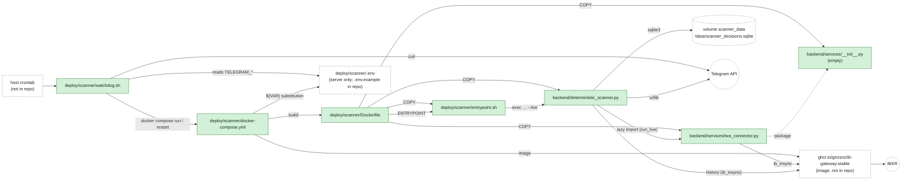
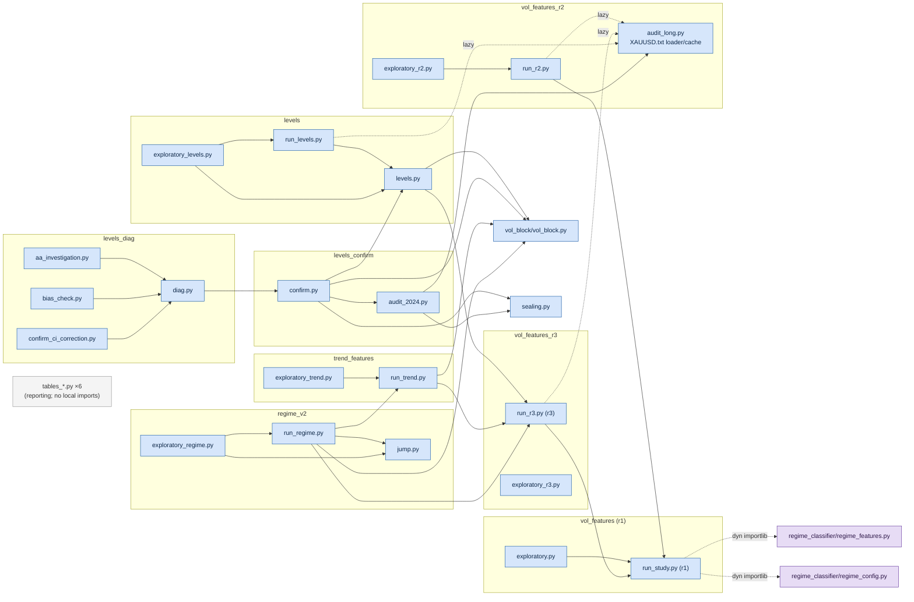
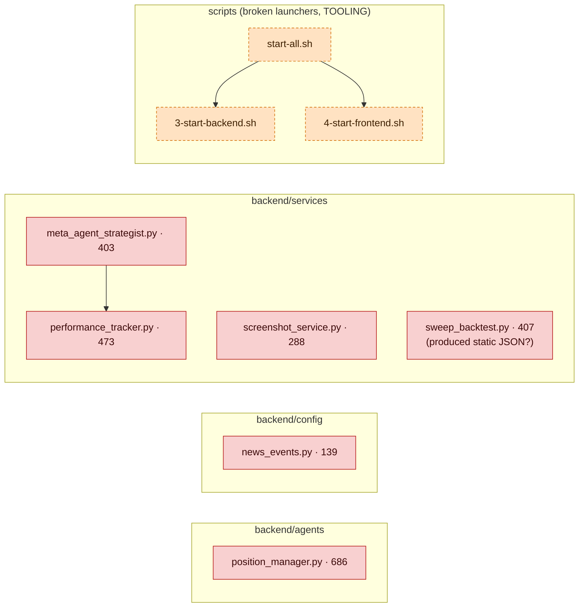

# OPARLI — Repo Map

> **Describes the pre-cleanup state.** Paths here are as of tag `legacy-agents-v0`. Phase 1 cleanup moved the agent framework to `legacy/` and `scraper_fxfac/` and `fetch_data_xauusd.py` to `tools/`; see `docs/CLEANUP_NOTES.md` for old → new paths.

*Generated 2026-10-13 from branch `research/levels-diag` (commit `29dec96`). This branch contains every commit of `pipeline-fixes-and-cleanup` (the branch EC2 deploys); the scanner and `deploy/scanner/` files are identical. Read-only survey: nothing was modified except creating this file. Companion to [ARCHITECTURE_MAP.md](ARCHITECTURE_MAP.md) (current state).*

> **`docs/TARGET_ARCHITECTURE.md` does not exist.** I checked this worktree, the main checkout, every local and remote branch, the stash, and `~/Desktop`, `~/Documents` and `~/Downloads`. The *target destination* column therefore uses only the destination vocabulary from the task (`oparli/{time,levels,features,stats,data,scanner,journal}`, `research/<study>`, `deploy/`, `oparli-agents/<module>`, `archive`, `delete`). The `<module>` names under `oparli-agents/` and the `archive` tags are my proposals. Treat the whole column as a draft to check against the target document once it exists.

---

## 1. Method

**Inventory.** All 152 tracked files matching `*.py`, `*.sh`, `*.ipynb`, `Dockerfile*` and `docker-compose*`. There are no untracked code files in the worktree. Skipped: `venv/`, `node_modules/`, `__pycache__/`, `research/*/cache/`, data/results/figures, Markdown, SQL, JSON and the Vue/JS frontend sources (not in the requested file types; the two frontend Docker files are included). Cron and systemd references are listed separately in §2 because none of them is a tracked file.

**Import graph.** I parsed every `.py` file and every notebook code cell with Python's `ast` and resolved each import against the same search path that file sets up for itself:
- its own folder;
- `backend/` (used by `run_system.py`, `tests/conftest.py`, and the `scripts/` that insert it);
- the repo root;
- `research/` and every `research/<study>/` (the research files add these with `sys.path.insert`).

No module name is defined twice apart from `__init__.py`, so resolving by name is unambiguous. Executing a submodule also counts as reaching its parent package's `__init__.py`.

**Edge kinds** (shown in brackets in the *reached from* column):
- *(no tag)*: a module-level import.
- **(lazy)**: an import written inside a function with a literal module name, e.g. `run_system.main()` imports the orchestrator, and `deterministic_scanner.run_live()` imports `tws_connector`. The target is known exactly; the only question is whether the function runs.
- **(dyn)**: `importlib.import_module` with a literal string. There is exactly one: `research/vol_features/run_study.py::_import_feature_engine` loads `regime_classifier.regime_features` and `regime_classifier.regime_config` by building a bare package. `run_r2.py` and `run_r3.py` import `run_study` as `r1`, and `run_trend.py` and `run_regime.py` reach it through `r1 = r3.r1`. `run_trend.py` calls `r1._import_feature_engine()` directly.
- **shell**: Dockerfile `COPY` / `ENTRYPOINT`, compose `build:`, an `exec`/`uvicorn` line in a shell script, or a launcher calling another launcher.

The task said to mark lazy and dynamic usage UNKNOWN. I resolved edges whose target is a literal name in the source and tagged them instead of marking them UNKNOWN. Calling `regime_features.py` "unknown" would hide the fact that three research studies depend on it. **UNKNOWN is used where the source cannot tell whether a file is used** (see §5.3).

**Entry points (roots)** and the status each one confers:

| Status | Roots |
|---|---|
| LIVE | `deploy/scanner/docker-compose.yml` (run on EC2) and `deploy/scanner/watchdog.sh` (host cron) → Dockerfile → `entrypoint.sh` → `backend/deterministic_scanner.py --live` |
| AGENT-FRAMEWORK | `backend/run_system.py`, `backend/main.py` (main.py's API/web tree is counted here; the status list has no separate API value) |
| RESEARCH | Every non-test `research/**/*.py` that is a standalone script. That means a `__main__` guard, or a shebang script named in its study's `DECISIONS.md`/`REPORT.md`. `research/*/run_*.py` alone would miss `levels_confirm/confirm.py`, `levels_diag/diag.py` and the `tables_*`/`exploratory_*` scripts |
| TEST | `tests/*.py`, `research/**/test_*.py`, `regime_classifier/tests/*` |
| TOOLING | Hand-run code: `scripts/**` (all have `__main__` or are shell), `notebooks/*`, `scraper_fxfac/*` |

**Status precedence** when a file is reached from several roots: LIVE > AGENT-FRAMEWORK > RESEARCH > TOOLING > TEST. Test files themselves are always TEST. DEAD means no root reaches the file.

**Lines** come from `wc -l`. For notebooks, the figure is the number of code-cell source lines.

---

## 2. Cron, systemd and scheduler references (not tracked files)

| Reference | Where it's defined | What it runs | Status |
|---|---|---|---|
| Host crontab `*/5 * * * * …/deploy/scanner/watchdog.sh` | Install instruction in the header of `watchdog.sh`; the actual crontab lives only on the server | `watchdog.sh` | LIVE (per owner notes; crontab not in repo) |
| IBC daily restart / Sunday cold restart | `deploy/scanner/docker-compose.yml` env `AUTO_RESTART_TIME`, `TWS_COLD_RESTART` | Inside the `ib-gateway` image | LIVE |
| Docker `restart: unless-stopped` | `docker-compose.yml` | Restarts both containers (the scanner's crash-only reconnect relies on it) | LIVE |
| systemd unit `oparli-api` | `scripts/deploy.sh` (`systemctl restart oparli-api`). **Unit file not in repo** | Presumably `uvicorn main:app`, but the unit content is unknown | UNKNOWN |
| `systemctl start/enable postgresql` | `scripts/setup-oracle-cloud.sh` | Postgres on the legacy Oracle host | archive |
| APScheduler (in-process, every 5 min) | `backend/main.py` startup | `SELECT refresh_all_timeframes()` | AGENT-FRAMEWORK |
| Agent scheduler thread (every 1 s) | `backend/core/scheduler.py` | Scanner + Trade Manager agents | AGENT-FRAMEWORK |

---

## 3. File table

`reached from` labels: **scanner** = the LIVE chain, **run_system** / **main** = the two agent-framework entry points, **research scripts**, **scripts/notebooks** (TOOLING roots), **tests**. "ATR functions" counts every function that computes ATR: 18 functions in 17 files (16 named `*atr*` plus `kl_atr_series` and `calc_atr` in notebooks). Session definitions: 4 (scanner/`backtest.ipynb`, `session_tracker.py`, `regime_config.py`, research NY day).

| path | lines | status | reached from | target destination | note |
|---|---|---|---|---|---|
| `backend/agents/__init__.py` | 18 | AGENT-FRAMEWORK | run_system (lazy), main (lazy), scripts/notebooks, tests | oparli-agents/agents | Re-exports the unused base_agent.AgentOrchestrator |
| `backend/agents/base_agent.py` | 309 | AGENT-FRAMEWORK | run_system (lazy), main (lazy), scripts/notebooks, tests | oparli-agents/core | Holds a 2nd, unused AgentOrchestrator class (duplicate of core/agent_orchestrator.py); outbox never drained |
| `backend/agents/execution_agent.py` | 419 | AGENT-FRAMEWORK | run_system (lazy) | oparli-agents/agents | BROKEN: mock fills only; INSERT names columns executed_trades lacks; no HARD_EXIT/MID_TRADE_ACTION handler |
| `backend/agents/meta_agent.py` | 817 | AGENT-FRAMEWORK | run_system (lazy), main (lazy), scripts/notebooks (lazy), tests | oparli-agents/agents | BROKEN LLM path: prompt needs {evolved_instructions}, formatter omits it → KeyError → deterministic fallback. Evolution mode uses dummy stats + undefined attrs |
| `backend/agents/position_manager.py` | 686 | DEAD | — | delete | ORPHANED; nothing imports it. Own ATR/RSI via SQL (1 of 18 ATR functions (17 files)) |
| `backend/agents/riskmanager_agent.py` | 348 | AGENT-FRAMEWORK | run_system (lazy), main (lazy), scripts/notebooks (lazy), tests | oparli-agents/agents | WIRED |
| `backend/agents/scanner_agent.py` | 520 | AGENT-FRAMEWORK | run_system (lazy), tests | oparli-agents/agents | LLM two-stage scanner, unrelated to deterministic_scanner. Stage 1 reads Postgres with no as_of |
| `backend/agents/sentimentanalyst_agent.py` | 334 | AGENT-FRAMEWORK | run_system (lazy), tests | oparli-agents/agents | Calls anthropic directly (bypasses llm_provider); receives no market_data, no news |
| `backend/agents/technicalanalyst_agent.py` | 401 | AGENT-FRAMEWORK | run_system (lazy), main (lazy), scripts/notebooks (lazy), tests | oparli-agents/agents | `_load_timeframe_data`/`_aggregate_ohlcv` duplicate market_data_provider |
| `backend/agents/trademanager_agent.py` | 452 | AGENT-FRAMEWORK | run_system (lazy) | oparli-agents/agents | BROKEN: TRADE_OPENED key mismatch (action/quantity/entry_time vs direction/position_size/fill_time). Only agent with an injected Clock |
| `backend/agents/visual_analyst_agent.py` | 299 | AGENT-FRAMEWORK | run_system (lazy), main (lazy), scripts/notebooks (lazy), tests | oparli-agents/agents | WIRED; prompt from DB visual_agent_policies or DEFAULT_VISUAL_PROMPT |
| `backend/config/__init__.py` | 6 | AGENT-FRAMEWORK | run_system (lazy), main, scripts/notebooks, tests | oparli-agents/config |  |
| `backend/config/database.py` | 155 | AGENT-FRAMEWORK | run_system (lazy), main, scripts/notebooks, tests | oparli-agents/config | psycopg2 pool from DATABASE_URL; scanner does not use Postgres |
| `backend/config/llm_provider.py` | 523 | AGENT-FRAMEWORK | run_system (lazy), main (lazy), scripts/notebooks, tests | oparli-agents/llm | Gemini/Claude factory; docstring mentions OpenAI, no client |
| `backend/config/news_events.py` | 139 | DEAD | — | archive (news) | Tier-1 event list; nothing imports it |
| `backend/core/agent_orchestrator.py` | 393 | AGENT-FRAMEWORK | run_system (lazy) | oparli-agents/core | Imports agents inside run_system.main() |
| `backend/core/message_bus.py` | 301 | AGENT-FRAMEWORK | run_system (lazy), tests | oparli-agents/core |  |
| `backend/core/scheduler.py` | 321 | AGENT-FRAMEWORK | run_system (lazy) | oparli-agents/core | Daemon thread, wall clock |
| `backend/deterministic_scanner.py` | 836 | LIVE | entrypoint.sh `exec python … --live` (Dockerfile COPY) | oparli/scanner (split: build_levels/LiveLevels→oparli/levels, journal fns→oparli/journal, SESSIONS/_market_open→oparli/time) | Level definition: UTC calendar day + ISO week (Sunday-evening bars fall in the previous week); differs from research (NY 17:00 day). Sessions ASIA 0–7 / LONDON 7–12 / NY 12–21 UTC, 1 of 4 session definitions. `record_outcome` has no caller |
| `backend/live_trading.py` | 297 | AGENT-FRAMEWORK | main, scripts/notebooks | oparli-agents/api | In-memory paper simulator for /api/live; balance hard-coded 10,000; broker TODO |
| `backend/main.py` | 603 | AGENT-FRAMEWORK | main, scripts/notebooks | oparli-agents/api | Entry point. Auto-starts TWS→Postgres streamer on startup. Server unit (systemd oparli-api) not in repo |
| `backend/middleware/__init__.py` | 3 | AGENT-FRAMEWORK | main, scripts/notebooks | oparli-agents/api |  |
| `backend/middleware/security.py` | 250 | AGENT-FRAMEWORK | main, scripts/notebooks | oparli-agents/api | API key also shipped in frontend bundle |
| `backend/routes/auth_routes.py` | 179 | AGENT-FRAMEWORK | main, scripts/notebooks | oparli-agents/api | Hard-coded default password fallback; dev-only password-hint route |
| `backend/routes/backtest_routes.py` | 107 | AGENT-FRAMEWORK | main, scripts/notebooks | oparli-agents/api | Serves static sweep_backtest_results.json |
| `backend/routes/dashboard_routes.py` | 688 | AGENT-FRAMEWORK | main, scripts/notebooks | oparli-agents/api | Parallel bus-free pipeline (/analyze): calls agents directly, skips Sentiment + governance |
| `backend/routes/data_management_routes.py` | 433 | AGENT-FRAMEWORK | main, scripts/notebooks | oparli-agents/api |  |
| `backend/routes/live_trading_routes.py` | 357 | AGENT-FRAMEWORK | main, scripts/notebooks | oparli-agents/api |  |
| `backend/routes/regime_routes.py` | 222 | AGENT-FRAMEWORK | main, scripts/notebooks | archive (regime-v1) | Lazy-imports regime_classifier; in-sample fit, no as_of |
| `backend/routes/validation_routes.py` | 333 | AGENT-FRAMEWORK | main, scripts/notebooks | archive (regime-v1) | Lazy-imports regime_classifier |
| `backend/run_system.py` | 122 | AGENT-FRAMEWORK | run_system | oparli-agents/runtime | Entry point; not deployed anywhere |
| `backend/services/__init__.py` | 0 | LIVE | Dockerfile COPY; every `services.*` import | oparli/data (package marker; replaced by oparli/__init__) | Empty file; copied into the scanner image |
| `backend/services/account_state_manager.py` | 396 | AGENT-FRAMEWORK | run_system (lazy), main (lazy), scripts/notebooks (lazy), tests | oparli-agents/risk |  |
| `backend/services/analysis/__init__.py` | 46 | AGENT-FRAMEWORK | run_system (lazy), main (lazy), scripts/notebooks, tests | oparli-agents/analysis |  |
| `backend/services/analysis/market_structure.py` | 397 | AGENT-FRAMEWORK | run_system (lazy), main (lazy), scripts/notebooks, tests | archive (smc) | Executed only as a side effect of services/analysis/__init__.py re-exports; no code calls it except notebooks/multi_agent_simulation.ipynb. 1 of 18 ATR functions (17 files) |
| `backend/services/analysis/meta_decision.py` | 540 | AGENT-FRAMEWORK | run_system (lazy), main (lazy), scripts/notebooks, tests | oparli-agents/analysis | DEFAULT_WEIGHTS technical 0.50 vs weight_manager 0.40; 2nd Meta prompt; agreement thresholds named inversely |
| `backend/services/analysis/visual_analysis.py` | 398 | AGENT-FRAMEWORK | run_system (lazy), main (lazy), scripts/notebooks, tests | oparli-agents/analysis |  |
| `backend/services/chart_generator.py` | 603 | AGENT-FRAMEWORK | run_system (lazy), main (lazy), scripts/notebooks (lazy), tests | oparli-agents/analysis | Direct SQL, no as_of; `_get_session_levels` is another level definition: session H/L from DB |
| `backend/services/clock.py` | 60 | AGENT-FRAMEWORK | run_system (lazy) | oparli/time | Clock/LiveClock/SimulatedClock; SimulatedClock has no call sites |
| `backend/services/confluence_checker.py` | 462 | AGENT-FRAMEWORK | run_system (lazy), main (lazy), scripts/notebooks, tests | oparli-agents/technical |  |
| `backend/services/database_writer.py` | 239 | AGENT-FRAMEWORK | main, scripts/notebooks | oparli-agents/ingest | Writes ohlcv_realtime_1min |
| `backend/services/entry_timing.py` | 319 | AGENT-FRAMEWORK | run_system (lazy), main (lazy), scripts/notebooks (lazy), tests | oparli-agents/technical |  |
| `backend/services/gap_detector.py` | 210 | AGENT-FRAMEWORK | main, scripts/notebooks | oparli-agents/ingest |  |
| `backend/services/governance.py` | 123 | AGENT-FRAMEWORK | run_system (lazy), main (lazy), scripts/notebooks (lazy), tests | oparli-agents/risk | Pure, no clock/DB |
| `backend/services/hard_limit_checker.py` | 220 | AGENT-FRAMEWORK | run_system (lazy), main (lazy), scripts/notebooks, tests | oparli-agents/risk |  |
| `backend/services/historical_backfill.py` | 457 | AGENT-FRAMEWORK | main, scripts/notebooks | oparli-agents/ingest | Port 4002 hard-coded |
| `backend/services/key_level_detector.py` | 225 | AGENT-FRAMEWORK | run_system (lazy), tests | oparli-agents/technical | level definition: indicator S/R + round numbers + swings (another level concept) |
| `backend/services/market_data_provider.py` | 257 | AGENT-FRAMEWORK | run_system (lazy), main (lazy), scripts/notebooks, tests | oparli/data | Live `<= as_of` vs Historical `< as_of` asymmetry; aggregation also duplicated in technicalanalyst_agent |
| `backend/services/market_data_streamer.py` | 589 | AGENT-FRAMEWORK | main, scripts/notebooks | oparli-agents/ingest | Port 4002 hard-coded; started by main.py |
| `backend/services/meta_agent_strategist.py` | 403 | DEAD | — | archive (evolution) | ORPHANED |
| `backend/services/performance_tracker.py` | 473 | DEAD | — | archive (evolution) | ORPHANED; placeholder logic |
| `backend/services/position_sizing.py` | 173 | AGENT-FRAMEWORK | run_system (lazy), main (lazy), scripts/notebooks, tests | oparli-agents/risk |  |
| `backend/services/regime_detector.py` | 295 | AGENT-FRAMEWORK | run_system (lazy), main (lazy), scripts/notebooks, tests | archive (regime-v1) | Slated for retirement; still on every technical signal path via timeframe_cascade (removal needs a replacement) |
| `backend/services/risk_service.py` | 175 | AGENT-FRAMEWORK | run_system (lazy), main (lazy), scripts/notebooks, tests | oparli-agents/risk |  |
| `backend/services/screenshot_service.py` | 288 | DEAD | — | delete | ORPHANED |
| `backend/services/session_tracker.py` | 418 | AGENT-FRAMEWORK | run_system (lazy), main, scripts/notebooks, tests | oparli-agents/ingest | Sessions Asian 0–9 / London 8–17 / NY 13–22 UTC, 1 of 4 session definitions, conflicts with the scanner's |
| `backend/services/stop_loss_calculator.py` | 203 | AGENT-FRAMEWORK | run_system (lazy), main (lazy), scripts/notebooks, tests | oparli-agents/risk |  |
| `backend/services/sweep_backtest.py` | 407 | DEAD | — | archive (smc) | No in-repo caller; presumably produced static/sweep_backtest_results.json. 1 of 18 ATR functions (17 files) |
| `backend/services/take_profit_calculator.py` | 168 | AGENT-FRAMEWORK | run_system (lazy), main (lazy), scripts/notebooks, tests | oparli-agents/risk |  |
| `backend/services/technical_indicators.py` | 355 | AGENT-FRAMEWORK | run_system (lazy), main (lazy), scripts/notebooks, tests | oparli/features | Candidate canonical ATR/RSI. 1 of 18 ATR functions (17 files) |
| `backend/services/technical_service.py` | 68 | AGENT-FRAMEWORK | run_system (lazy), main (lazy), scripts/notebooks, tests | oparli-agents/technical |  |
| `backend/services/throttle_manager.py` | 281 | AGENT-FRAMEWORK | run_system (lazy), tests | oparli-agents/agents |  |
| `backend/services/timeframe_cascade.py` | 433 | AGENT-FRAMEWORK | run_system (lazy), main (lazy), scripts/notebooks, tests | oparli-agents/technical | Depends on regime_detector |
| `backend/services/trigger_monitor.py` | 385 | AGENT-FRAMEWORK | run_system (lazy), tests | oparli-agents/agents | Volatility trigger is a TODO stub |
| `backend/services/tws_connector.py` | 694 | LIVE | deterministic_scanner (lazy, in run_live; confirmed by Dockerfile COPY); main → market_data_streamer; historical_backfill | oparli/data | Shared by scanner and API streamer/backfill. Default port 7497 vs 4002/4004 elsewhere. In-place reconnect resubscribe is a stub (scanner uses crash-only restart) |
| `backend/services/weight_manager.py` | 376 | AGENT-FRAMEWORK | run_system (lazy), main (lazy), scripts/notebooks (lazy), tests | oparli-agents/analysis | Defaults .35/.40/.25 differ from meta_decision/backtest .35/.50/.15; update path has no caller |
| `deploy/scanner/Dockerfile` | 21 | LIVE | docker-compose.yml `build:` | deploy/ | COPYs exactly 3 .py files + entrypoint; pins pandas/numpy |
| `deploy/scanner/docker-compose.yml` | 58 | LIVE | EC2 `docker compose up -d`; watchdog.sh | deploy/ | ibgateway + scanner services; header still says Oracle |
| `deploy/scanner/entrypoint.sh` | 24 | LIVE | Dockerfile ENTRYPOINT | deploy/ | API-handshake wait, then exec scanner |
| `deploy/scanner/watchdog.sh` | 81 | LIVE | host crontab (install line in its header; crontab not in repo) | deploy/ | Host-side; reads deploy/.env for Telegram; ≤2 re-logins/24h |
| `frontend/Dockerfile` | 11 | UNKNOWN | nothing in repo builds it (no compose/CI/script) | oparli-agents/web | Deploy actually uses `npm run build` + rsync in scripts/deploy.sh; entrypoint `cd /app/frontend` doesn't match WORKDIR /app |
| `frontend/entrypoint-frontend.sh` | 9 | UNKNOWN | frontend/Dockerfile only | oparli-agents/web |  |
| `notebooks/backtest.ipynb` | 983 | TOOLING | scripts/notebooks | archive (levels-origin) | Source of the scanner's level engine (`_SESSIONS` identical); reads the scanner parquet; 1 of 18 ATR functions (17 files) (kl_atr_series) |
| `notebooks/multi_agent_simulation.ipynb` | 1320 | TOOLING | scripts/notebooks | archive (agents-sim) | Inserts backend/ on sys.path; imports agents/services |
| `notebooks/smc_validation_backtest.ipynb` | 2257 | TOOLING | scripts/notebooks | archive (smc) | 1 of 18 ATR functions (17 files) (calc_atr); computes PDH |
| `regime_classifier/__init__.py` | 21 | AGENT-FRAMEWORK | main (lazy), scripts/notebooks, tests | archive (regime-v1) | Imports jumpmodels/sklearn/joblib; not installed in backend venv |
| `regime_classifier/regime_classifier.py` | 585 | AGENT-FRAMEWORK | main (lazy), scripts/notebooks, tests | archive (regime-v1) |  |
| `regime_classifier/regime_config.py` | 74 | AGENT-FRAMEWORK | main (lazy), research scripts (dyn), scripts/notebooks, tests | oparli/features (or vendor into research/vol_features) | Research loads it via importlib (literal name). Sessions Asian 0–8 / London 8–12 / Overlap 12–16 / NY 16–21, 1 of 4 session definitions. Don't archive without moving it |
| `regime_classifier/regime_features.py` | 566 | AGENT-FRAMEWORK | main (lazy), research scripts (dyn), scripts/notebooks, tests | oparli/features (or vendor into research/vol_features) | Research (vol_features r1–r3, trend_features) loads it via importlib. 1 of 18 ATR functions (17 files) (_atr). Don't archive without moving it |
| `regime_classifier/regime_validator.py` | 699 | AGENT-FRAMEWORK | main (lazy), scripts/notebooks, tests | archive (regime-v1) |  |
| `regime_classifier/tests/__init__.py` | 0 | TEST | tests | archive (regime-v1) |  |
| `regime_classifier/tests/test_regime_classifier.py` | 292 | TEST | pytest | archive (regime-v1) | Can't run here: joblib/jumpmodels missing |
| `research/levels/exploratory_levels.py` | 76 | RESEARCH | research scripts | research/levels |  |
| `research/levels/levels.py` | 432 | RESEARCH | research scripts, tests | research/levels (extract touch/break/sweep detectors→oparli/levels, bootstrap/BH→oparli/stats) | Level definition: NY 17:00 trading day, 80% coverage; differs from the scanner's UTC day |
| `research/levels/run_levels.py` | 283 | RESEARCH | research scripts | research/levels |  |
| `research/levels/tables_levels.py` | 50 | RESEARCH | standalone script (named in DECISIONS.md) | research/levels | Reporting only |
| `research/levels/test_levels.py` | 219 | TEST | pytest | research/levels |  |
| `research/levels_confirm/audit_2024.py` | 131 | RESEARCH | research scripts, tests | research/levels_confirm |  |
| `research/levels_confirm/confirm.py` | 357 | RESEARCH | research scripts, tests | research/levels_confirm | Imported by levels_diag/diag.py |
| `research/levels_confirm/test_confirm.py` | 135 | TEST | pytest | research/levels_confirm |  |
| `research/levels_diag/aa_investigation.py` | 62 | RESEARCH | standalone script (named in DECISIONS.md, REPORT.md) | research/levels_diag |  |
| `research/levels_diag/bias_check.py` | 37 | RESEARCH | standalone script (named in DECISIONS.md) | research/levels_diag |  |
| `research/levels_diag/confirm_ci_correction.py` | 65 | RESEARCH | research scripts | research/levels_diag |  |
| `research/levels_diag/diag.py` | 428 | RESEARCH | research scripts, tests | research/levels_diag (block bootstrap→oparli/stats) |  |
| `research/levels_diag/test_diag.py` | 70 | TEST | pytest | research/levels_diag |  |
| `research/regime_v2/exploratory_regime.py` | 88 | RESEARCH | research scripts | research/regime_v2 |  |
| `research/regime_v2/jump.py` | 164 | RESEARCH | research scripts, tests | research/regime_v2 | 3rd regime implementation (after regime_detector, regime_classifier) |
| `research/regime_v2/run_regime.py` | 518 | RESEARCH | research scripts, tests | research/regime_v2 |  |
| `research/regime_v2/tables_regime.py` | 71 | RESEARCH | standalone script (named in DECISIONS.md) | research/regime_v2 | Reporting only |
| `research/regime_v2/test_regime.py` | 117 | TEST | pytest | research/regime_v2 |  |
| `research/sealing.py` | 20 | RESEARCH | research scripts, tests | research/ (shared, sealing) | Global data seal ≥ 2026-10-01 |
| `research/test_sealing.py` | 26 | TEST | pytest | research/ (shared, sealing) |  |
| `research/trend_features/exploratory_trend.py` | 64 | RESEARCH | research scripts | research/trend_features |  |
| `research/trend_features/run_trend.py` | 329 | RESEARCH | research scripts, tests | research/trend_features | Uses regime_features via run_study._import_feature_engine (importlib) |
| `research/trend_features/tables_trend.py` | 37 | RESEARCH | standalone script (named in DECISIONS.md) | research/trend_features | Reporting only |
| `research/trend_features/test_trend.py` | 135 | TEST | pytest | research/trend_features |  |
| `research/vol_block/test_vol_block.py` | 105 | TEST | pytest | research/vol_block |  |
| `research/vol_block/vol_block.py` | 139 | RESEARCH | research scripts, tests | oparli/features | Shared by levels, levels_confirm, trend_features, regime_v2 |
| `research/vol_features/exploratory.py` | 111 | RESEARCH | research scripts | research/vol_features |  |
| `research/vol_features/run_study.py` | 676 | RESEARCH | research scripts, tests | research/vol_features (helpers log/minute_returns/hourly_bars→oparli/data, ols/dm_test→oparli/stats) | Imported as `r1` by r2, r3, trend, regime_v2. Dynamic import of regime_classifier |
| `research/vol_features/test_vol_features.py` | 201 | TEST | pytest | research/vol_features |  |
| `research/vol_features_r2/audit_long.py` | 242 | RESEARCH | research scripts, tests | research/vol_features_r2 (XAUUSD.txt loader/cache→oparli/data) | Lazily imported by run_r2, run_r3, run_levels |
| `research/vol_features_r2/exploratory_r2.py` | 106 | RESEARCH | research scripts | research/vol_features_r2 |  |
| `research/vol_features_r2/run_r2.py` | 432 | RESEARCH | research scripts, tests | research/vol_features_r2 |  |
| `research/vol_features_r2/tables_r2.py` | 58 | RESEARCH | standalone script (named in r2 + r3 DECISIONS.md) | research/vol_features_r2 | Reporting only |
| `research/vol_features_r2/test_r2.py` | 185 | TEST | pytest | research/vol_features_r2 |  |
| `research/vol_features_r3/exploratory_r3.py` | 37 | RESEARCH | standalone script (named in DECISIONS.md, REPORT.md §6) | research/vol_features_r3 |  |
| `research/vol_features_r3/run_r3.py` | 440 | RESEARCH | research scripts, tests | research/vol_features_r3 (loader + seal helpers→oparli/data) | Imported as `r3` by levels, trend, regime_v2, vol_block tests |
| `research/vol_features_r3/tables_r3.py` | 58 | RESEARCH | standalone script (named in DECISIONS.md) | research/vol_features_r3 | Reporting only |
| `research/vol_features_r3/test_r3.py` | 234 | TEST | pytest | research/vol_features_r3 |  |
| `scraper_fxfac/calendar_web_scape.py` | 152 | TOOLING | scripts/notebooks | oparli/data (events) | Manual; output feeds database/historical_news (research notes), no code consumer |
| `scripts/3-start-backend.sh` | 6 | TOOLING | scripts/notebooks | delete | Broken: `cd $(dirname $0)/backend` → scripts/backend doesn't exist |
| `scripts/4-start-frontend.sh` | 6 | TOOLING | scripts/notebooks | delete | Broken: same path bug |
| `scripts/analyze_backtest.py` | 203 | TOOLING | scripts/notebooks | archive (smc) |  |
| `scripts/asian_london_regression.py` | 592 | TOOLING | scripts/notebooks | archive (sessions) | 1 of 18 ATR functions (17 files) (+ compute_atr_15m) |
| `scripts/backfill/backfill_month.py` | 118 | TOOLING | scripts/notebooks | oparli-agents/ingest | Hard-codes a server path on sys.path; port/host inline |
| `scripts/backfill/export_backtest_data.py` | 119 | TOOLING | scripts/notebooks | oparli-agents/ingest | Runs psql over ssh via subprocess (external) |
| `scripts/backfill/fetch_data.py` | 166 | TOOLING | scripts/notebooks | oparli-agents/ingest | Futures fetch |
| `scripts/backfill/fetch_data_xauusd.py` | 150 | TOOLING | scripts/notebooks | oparli/data | Produces XAUUSD_COMPLETE.csv (backtest CSV) |
| `scripts/backfill/import_csv.py` | 124 | TOOLING | scripts/notebooks | oparli-agents/ingest |  |
| `scripts/backfill/import_csv_to_postgres.py` | 224 | TOOLING | scripts/notebooks | oparli-agents/ingest | pip-installs psycopg2 at runtime via os.system |
| `scripts/backtest_agents.py` | 343 | TOOLING | scripts/notebooks | oparli-agents/backtest | 3rd orchestration path; own weight update + DEFAULT_WEIGHTS (technical .50) |
| `scripts/connect.sh` | 29 | TOOLING | scripts/notebooks | archive (legacy-host) | SSH tunnel + POST /api/streaming/start |
| `scripts/demo_backtestable_technical.py` | 76 | TOOLING | scripts/notebooks | archive (agents-demo) |  |
| `scripts/deploy.sh` | 35 | TOOLING | scripts/notebooks | deploy/ | API + website deploy (rsync + `systemctl restart oparli-api`); hard-codes server address and key path in a public repo |
| `scripts/no_go_strategies/smc_backtest_fvg.py` | 584 | TOOLING | scripts/notebooks | archive (no-go) | 1 of 18 ATR functions (17 files) |
| `scripts/no_go_strategies/smc_backtest_orderblocks.py` | 459 | TOOLING | scripts/notebooks | archive (no-go) | 1 of 18 ATR functions (17 files) |
| `scripts/no_go_strategies/smc_backtest_regime.py` | 317 | TOOLING | scripts/notebooks | archive (no-go) |  |
| `scripts/regime_strategy_backtest.py` | 989 | TOOLING | scripts/notebooks | archive (regime-v1) | 1 of 18 ATR functions (17 files) |
| `scripts/run_walk_forward.py` | 193 | TOOLING | scripts/notebooks | archive (regime-v1) |  |
| `scripts/setup-oracle-cloud.sh` | 105 | TOOLING | scripts/notebooks | archive (legacy-host) | Oracle provisioning; installs Postgres + schema.sql |
| `scripts/smc_backtest_orb.py` | 695 | TOOLING | scripts/notebooks | archive (smc) |  |
| `scripts/smc_backtest_orb_fade.py` | 488 | TOOLING | scripts/notebooks | archive (smc) | 1 of 18 ATR functions (17 files) |
| `scripts/smc_backtest_sweeps.py` | 468 | TOOLING | scripts/notebooks | archive (smc) | 1 of 18 ATR functions (17 files) |
| `scripts/smc_bos_choch_validation.py` | 677 | TOOLING | scripts/notebooks | archive (smc) | 1 of 18 ATR functions (17 files) |
| `scripts/smc_fvg_leads_ob_validation.py` | 529 | TOOLING | scripts/notebooks | archive (smc) | 1 of 18 ATR functions (17 files) |
| `scripts/smc_validation_train_test.py` | 877 | TOOLING | scripts/notebooks | archive (smc) | 1 of 18 ATR functions (17 files); matches test_* glob by name only, it's a script |
| `scripts/start-all.sh` | 42 | TOOLING | scripts/notebooks | delete | Hard-codes an absolute local path; calls the two broken launchers |
| `scripts/visualize_sweep_trades.py` | 515 | TOOLING | scripts/notebooks | archive (smc) | 1 of 18 ATR functions (17 files) |
| `tests/conftest.py` | 26 | TEST | pytest | oparli-agents/tests | Inserts backend/ on sys.path |
| `tests/test_meta_renormalization.py` | 125 | TEST | pytest | oparli-agents/tests |  |
| `tests/test_pipeline_integration.py` | 448 | TEST | pytest | oparli-agents/tests | Stops at Risk Manager; Execution/Trade Manager untested |

---

## 4. Diagrams

Colours: LIVE green · AGENT-FRAMEWORK purple · RESEARCH blue · TOOLING orange · TEST grey · DEAD red · UNKNOWN yellow · external dashed.

### 4a. Production: everything the live scanner container touches, plus the watchdog

Nothing else from the repo is inside the scanner image. The replay/selftest parquet `database/ohlcv_data/XAUUSD_1min_UTC_clean.parquet` is *not* in the image; only `--date` and `--selftest` read it.

### 4b. Research modules and their imports

Tests (10 `test_*.py` files) are left out to keep the chart readable. Each imports its own study's modules; `test_vol_block.py` also imports `run_r3`.

`exploratory_r3.py` imports no local module. Research imports nothing from `backend/`. **Its only link to the rest of the repo is the dynamic import of `regime_classifier/regime_features.py` + `regime_config.py`.** Only `confirm.py` and `audit_2024.py` (and through them `levels_diag`) import `sealing.py`. The r1–r3/trend/regime studies seal through their own helpers in `run_r3`/`run_study`.

### 4c. Agent framework today

Status per [ARCHITECTURE_MAP.md](ARCHITECTURE_MAP.md) §2: **WIRED** = reachable and working, **BROKEN** = reachable but fails at runtime, **ORPHANED** = nothing calls it, **STUB** = placeholder logic.

```mermaid
flowchart TD
  classDef wired fill:#d3f0d8,stroke:#2e7d32,color:#10301a
  classDef broken fill:#ffd9cc,stroke:#c0392b,color:#4a120a
  classDef orphan fill:#eeeeee,stroke:#888,stroke-dasharray:4 3,color:#444
  classDef stub fill:#fff3c4,stroke:#b8860b,color:#3d2c00
  classDef entry fill:#e7dcf5,stroke:#6a3fa0,color:#2b1546

  rs["run_system.py"]:::entry
  mn["main.py (API)"]:::entry
  orch["core/agent_orchestrator.py"]:::wired
  bus["core/message_bus.py"]:::wired
  sch["core/scheduler.py"]:::wired
  boa["base_agent.AgentOrchestrator"]:::orphan
  dash["routes/dashboard_routes.py<br/>(bus-free pipeline)"]:::wired

  sc["scanner_agent"]:::wired
  ta["technicalanalyst_agent"]:::wired
  va["visual_analyst_agent"]:::wired
  sa["sentimentanalyst_agent<br/>no data, no news"]:::stub
  ma["meta_agent<br/>LLM path KeyError; evolution dummy"]:::broken
  rm["riskmanager_agent"]:::wired
  ex["execution_agent<br/>mock fills; INSERT drift"]:::broken
  tm["trademanager_agent<br/>TRADE_OPENED KeyError"]:::broken
  pm["position_manager.py"]:::orphan

  tech["technical_service → timeframe_cascade →<br/>technical_indicators, confluence_checker, entry_timing"]:::wired
  rd["regime_detector (to retire)"]:::wired
  risk["risk_service + hard_limit / SL / TP / sizing,<br/>account_state_manager"]:::wired
  md["analysis/meta_decision"]:::wired
  vis["analysis/visual_analysis"]:::wired
  gov["governance (wired) ·<br/>weight_manager (update path unused)"]:::stub
  llm["config/llm_provider"]:::wired
  mdp["market_data_provider · clock<br/>(SimulatedClock unused)"]:::wired
  trig["trigger_monitor (vol trigger stub) ·<br/>throttle_manager · key_level_detector · chart_generator"]:::wired
  strat["meta_agent_strategist ·<br/>performance_tracker"]:::orphan

  rs --> orch --> bus & sch
  orch --> sc & ta & va & sa & ma & rm & ex & tm
  sch --> sc & tm
  sc --> trig & ta
  ta --> tech --> rd
  ta & ex & tm --> mdp
  va --> vis & llm
  ma --> md & gov & llm
  rm --> risk
  mn --> dash --> va & ta & ma & rm
  ma -. "MID_TRADE_ACTION (no handler)" .-> ex
  tm -. "HARD_EXIT (no handler)" .-> ex
  ex -. "TRADE_OPENED (KeyError)" .-> tm
  strat -. "never called" .-> md
```

### 4d. Dead code (no entry point reaches it), by folder

Also shown: tooling files the table sends to `delete` because they're broken.

Dead *code inside live files* (not files, so not in the table's DEAD count):
- `deterministic_scanner.record_outcome`
- `base_agent.AgentOrchestrator`
- `MetaAgentNew.update_weights_after_trade` and `run_monthly_evolution`
- `TechnicalAnalystAgent._load_timeframe_data` (alive only via Stage 1)
- `trigger_monitor._check_volatility_change`
- `/api/dashboard/history`

`services/analysis/market_structure.py` runs only as a side effect of its package `__init__`; nothing calls it outside a notebook.

### 4e. Migration: current folders → target destinations (proposal)

```mermaid
flowchart LR
  classDef live fill:#d3f0d8,stroke:#2e7d32,color:#10301a
  classDef agent fill:#e7dcf5,stroke:#6a3fa0,color:#2b1546
  classDef res fill:#d6e6fb,stroke:#1f5fa8,color:#0d2747
  classDef tool fill:#ffe2c2,stroke:#d4730c,color:#3d1f00
  classDef dead fill:#f8d0d0,stroke:#b71c1c,color:#3b0909
  classDef tgt fill:#ffffff,stroke:#333,color:#111

  subgraph NOW["current"]
    dsc["deploy/scanner/*"]:::live
    dsp["backend/deterministic_scanner.py"]:::live
    twsc["services/tws_connector.py"]:::live
    prov["services/market_data_provider.py<br/>services/clock.py"]:::agent
    ti["services/technical_indicators.py"]:::agent
    ag["backend/agents · core · config"]:::agent
    api["backend/main · routes · middleware · live_trading"]:::agent
    svc["backend/services (technical, risk, analysis)"]:::agent
    ing["services: streamer, db_writer, backfill,<br/>gap_detector, session_tracker; scripts/backfill"]:::agent
    reg1["services/regime_detector · regime_classifier/*<br/>(minus features/config) · regime/validation routes"]:::agent
    rfc["regime_classifier/regime_features.py<br/>+ regime_config.py"]:::agent
    rshared["research shared helpers:<br/>vol_block · run_study/run_r3/audit_long helpers ·<br/>levels.py detectors · diag/levels bootstrap"]:::res
    rstud["research/&lt;study&gt;/* (rest)"]:::res
    bta["scripts/backtest_agents.py · tests/"]:::tool
    smc["scripts/smc_* · no_go_strategies · analyze/visualize ·<br/>asian_london · notebooks · sweep_backtest"]:::tool
    ops["scripts/deploy.sh"]:::tool
    legacy["setup-oracle-cloud.sh · connect.sh"]:::tool
    fe["frontend/Dockerfile + entrypoint"]:::tool
    dead["position_manager · screenshot_service ·<br/>3-/4-start-*.sh · start-all.sh"]:::dead
    evo["meta_agent_strategist · performance_tracker ·<br/>news_events"]:::dead
  end

  subgraph TGT["target"]
    t_time["oparli/time"]:::tgt
    t_lvl["oparli/levels"]:::tgt
    t_feat["oparli/features"]:::tgt
    t_stats["oparli/stats"]:::tgt
    t_data["oparli/data"]:::tgt
    t_scan["oparli/scanner"]:::tgt
    t_jour["oparli/journal"]:::tgt
    t_res["research/&lt;study&gt;"]:::tgt
    t_dep["deploy/"]:::tgt
    t_agents["oparli-agents/*"]:::tgt
    t_arch["archive"]:::tgt
    t_del["delete"]:::tgt
  end

  dsc --> t_dep
  ops --> t_dep
  dsp -- "Scanner, run_live" --> t_scan
  dsp -- "build_levels, LiveLevels" --> t_lvl
  dsp -- "open_log, record_*, sweeps" --> t_jour
  dsp -- "SESSIONS, _market_open" --> t_time
  twsc --> t_data
  prov -- "provider" --> t_data
  prov -- "clock" --> t_time
  ti --> t_feat
  rfc --> t_feat
  rshared -- "vol_block" --> t_feat
  rshared -- "loaders, seal helpers" --> t_data
  rshared -- "bootstrap, BH, OLS, DM test" --> t_stats
  rshared -- "touch/break/sweep detectors" --> t_lvl
  rstud --> t_res
  ag & api & svc & ing & bta & fe --> t_agents
  reg1 & smc & legacy & evo --> t_arch
  dead --> t_del
```

---

## 5. Summary

### 5.1 Counts and lines per status (152 files, 45,826 lines)

| Status | Files | Lines | What's in it |
|---|---:|---:|---|
| LIVE | 7 | 1,714 | `deterministic_scanner.py`, `tws_connector.py`, `services/__init__.py`, 4 deploy files |
| AGENT-FRAMEWORK | 62 | 20,026 | agents, core, config, routes, API, agent services, `regime_classifier/*` (via the lazy API import) |
| RESEARCH | 28 | 5,511 | research modules and standalone study scripts |
| TOOLING | 32 | 13,841 | `scripts/**`, notebooks, scraper |
| TEST | 15 | 2,318 | `tests/`, research `test_*.py`, `regime_classifier/tests` |
| DEAD | 6 | 2,396 | `position_manager`, `news_events`, `meta_agent_strategist`, `performance_tracker`, `screenshot_service`, `sweep_backtest` |
| UNKNOWN | 2 | 20 | `frontend/Dockerfile`, `frontend/entrypoint-frontend.sh` |

The LIVE scanner is 3.7% of the code. 1,530 of its 1,714 lines are Python, and only `deterministic_scanner.py` (836) and `tws_connector.py` (694) contain logic.

### 5.2 Duplicated concepts

| Concept | Files |
|---|---|
| **ATR** (18 functions, 17 files) | `backend/services/technical_indicators.py` · `backend/services/analysis/market_structure.py` · `backend/agents/position_manager.py` (SQL) · `backend/services/sweep_backtest.py` · `regime_classifier/regime_features.py` (used by research via importlib) · `scripts/asian_london_regression.py` (×2 incl. 15m) · `scripts/regime_strategy_backtest.py` · `scripts/smc_backtest_orb_fade.py` · `scripts/smc_backtest_sweeps.py` · `scripts/smc_bos_choch_validation.py` · `scripts/smc_fvg_leads_ob_validation.py` · `scripts/smc_validation_train_test.py` · `scripts/visualize_sweep_trades.py` · `scripts/no_go_strategies/smc_backtest_fvg.py` · `scripts/no_go_strategies/smc_backtest_orderblocks.py` · `notebooks/backtest.ipynb` (`kl_atr_series`) · `notebooks/smc_validation_backtest.ipynb` (`calc_atr`) |
| **Key levels (PDH/PDL/PWH/PWL, session H/L)** | `backend/deterministic_scanner.py` (UTC day, ISO week) · `notebooks/backtest.ipynb` (its origin) · `research/levels/levels.py` (NY 17:00 day, 80% coverage) · `backend/services/session_tracker.py` (DB `session_levels`) · `backend/services/chart_generator.py::_get_session_levels` · `backend/services/key_level_detector.py` (indicator S/R, round numbers) · `notebooks/smc_validation_backtest.ipynb` (PDH) |
| **Session hours** (4 definitions) | scanner + `backtest.ipynb`: ASIA 0–7 / LONDON 7–12 / NY 12–21 UTC · `session_tracker.py`: 0–9 / 8–17 / 13–22 · `regime_classifier/regime_config.py`: 0–8 / 8–12 / overlap 12–16 / NY 16–21 · `research/levels/levels.py`: NY 17:00 trading day |
| **Regime** | `backend/services/regime_detector.py` · `regime_classifier/` · `research/regime_v2/jump.py` |
| **Orchestration of the agent pipeline** | `backend/core/agent_orchestrator.py` (bus) · `backend/agents/base_agent.py::AgentOrchestrator` (unused) · `backend/routes/dashboard_routes.py` (`/analyze`) · `scripts/backtest_agents.py` · `notebooks/multi_agent_simulation.ipynb` |
| **Meta weights + update rule** | `backend/services/weight_manager.py` (.35/.40/.25) · `backend/services/analysis/meta_decision.py` and `scripts/backtest_agents.py` (.35/.50/.15; backtest re-implements ×1.05/×0.95) |
| **Meta prompt** | `backend/agents/meta_agent.py::META_AGENT_PROMPT_TEMPLATE` · `backend/services/analysis/meta_decision.py::DEFAULT_META_PROMPT` |
| **OHLCV load + resample** | `backend/services/market_data_provider.py` · `backend/agents/technicalanalyst_agent.py::_load_timeframe_data/_aggregate_ohlcv` · `backend/services/chart_generator.py` |
| **Paper trading** | `backend/live_trading.py` · `backend/agents/execution_agent.py` mock + `trademanager_agent.py` |
| **Price-data loaders** | `research/vol_features_r2/audit_long.py` + `research/vol_features_r3/run_r3.py` (`XAUUSD.txt`) · `deterministic_scanner.load_data` (parquet) · `scripts/backtest_agents.py` and the smc scripts (`XAUUSD_COMPLETE.csv`) |
| **IBKR historical fetch** | `deterministic_scanner._load_recent_history` · `services/historical_backfill.py` · `scripts/backfill/backfill_month.py` · `fetch_data.py` · `fetch_data_xauusd.py` |

### 5.3 Could not resolve

- **Target architecture document.** It doesn't exist, so every destination is a proposal (see the top of this file).
- **`frontend/Dockerfile` + `entrypoint-frontend.sh` (UNKNOWN).** No compose file, CI or script builds this image. The real website deploy is `npm run build` + rsync in `scripts/deploy.sh`. The entrypoint's `cd /app/frontend` doesn't match `WORKDIR /app`.
- **systemd `oparli-api`.** The unit file isn't in the repo, so the exact command, user and whether it's running are unknown.
- **Data provenance.** No tracked code writes `XAUUSD_1min_UTC_clean.parquet` (scanner replay/selftest, research r1/r2) or `XAUUSD.txt` (research). Both are read but never produced in the repo. `XAUUSD_COMPLETE.csv` is produced by `scripts/backfill/fetch_data_xauusd.py`.
- **Which TOOLING scripts are still run.** Static analysis can only say they're runnable by hand, not whether anyone runs them.
- **Whether the 18 ATR functions agree numerically** (Wilder vs simple mean, period handling). Not tested.
- **The research `tables_*` / `exploratory_*` scripts** are classified RESEARCH because their study docs name them. I didn't re-run them.

### 5.4 Verification

- **Each file exactly once.** The 152 table rows were generated from the same `git ls-files` list as the inventory. A script assertion checked that the hand-written destination map has no missing or extra paths. After writing this file, a parse of the table confirmed 152 rows, 152 unique paths, and an exact match with the inventory.
- **LIVE files really are reachable from the scanner entry point.** The 7 LIVE files are the compose file, `watchdog.sh` (the two roots), the Dockerfile (compose `build:`), `entrypoint.sh` (Dockerfile `ENTRYPOINT`), `deterministic_scanner.py` (`exec` in `entrypoint.sh`), and `services/__init__.py` + `services/tws_connector.py` (explicit Dockerfile `COPY` lines, plus the import in `run_live`). `deterministic_scanner.py` imports no other repo module, and `tws_connector.py` imports none at all.
