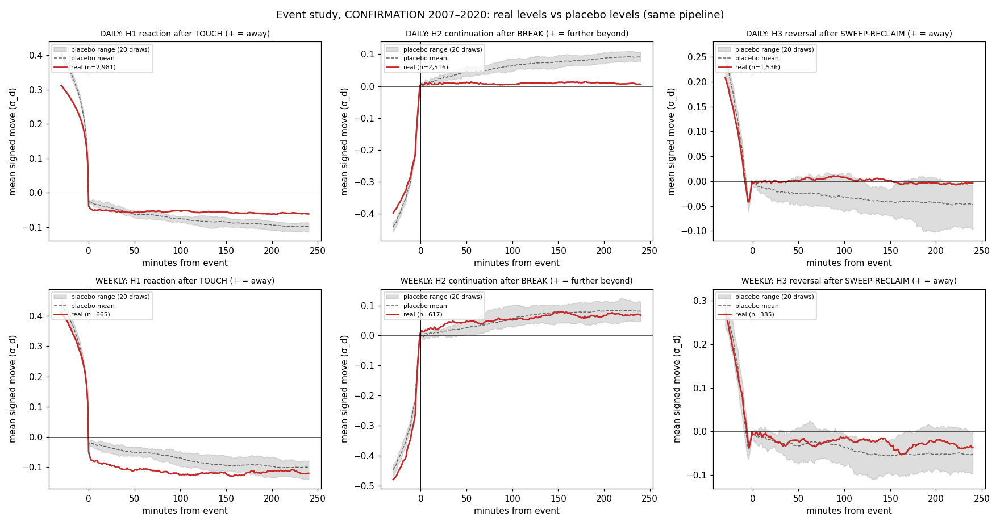

# Level behaviour study: report

Does gold behave differently at PDH/PDL/WH/WL than at placebo levels that go
through the identical pipeline? A measurement study, not a backtest. PREREG
`f0e3fd4` (before any result). Decisions: [DECISIONS.md](DECISIONS.md). All
tables (per-year counts, the full robustness grid, every secondary cell):
[results/summary_levels.md](results/summary_levels.md). Data: `XAUUSD.txt` 1-min
UTC. CONFIRMATION 2007–2020 (eras 2007–13 / 2014–20), REPLICATION 2021–2023. No
timestamp at or after 2024-01-01 was used (asserts on the loader, events and
outcome windows). 23 trading days (2007–2023) fell below 80 % of the minutes and
were excluded. 27,501 real level-periods, each with 20 placebos (none short),
769,509 events in all.

## 1. Verdict (6 primary tests, CONFIRMATION, b = 0.3 σ_d, 240 min)

| Test | real | placebo | effect | 95 % CI | BH p | era 1 / era 2 | REPL effect (p) | Verdict |
|---|---:|---:|---:|---|---:|---|---|---|
| DAILY H1 touch → reaction | 31.6 % | 32.8 % | −1.2 pp | [−3.1, +0.8] | 1.00 | −2.1 / −0.3 | +2.6 (0.12) | not supported |
| DAILY H2 break → continuation | 42.4 % | 49.7 % | **−7.3 pp** | [−9.6, −5.0] | 1.00 | −8.0 / −6.6 | −3.2 (0.90) | not supported (**opposite sign**) |
| DAILY H3 sweep-reclaim → reversal | 38.5 % | 35.0 % | **+3.5 pp** | [+0.4, +6.7] | 0.085 | **−0.9** / +7.1 | **+8.9 (0.002)** | not supported; replicated |
| WEEKLY H1 | 30.2 % | 35.0 % | −4.8 pp | [−8.6, −0.9] | 1.00 | −3.0 / −6.7 | +1.6 (0.34) | not supported |
| WEEKLY H2 | 50.6 % | 47.6 % | +3.0 pp | [−1.2, +7.1] | 0.26 | +0.5 / +5.7 | +2.8 (0.28) | not supported |
| WEEKLY H3 | 38.4 % | 38.3 % | +0.1 pp | [−5.2, +5.8] | 0.96 | +1.8 / −1.4 | +0.9 (0.43) | not supported |

**No hypothesis is SUPPORTED.** DAILY H3 is the closest: raw p 0.014 and +3.5
pp, but it fails BH (0.085) and the era rule (negative in 2007–13). It does
meet the replication criterion. **The clearest effect goes against the
pre-registered direction:** breaks of PDH/PDL continue *less* than breaks of
placebo levels, negative in both eras and in replication. One-sided tests don't
count that as support, but it is not noise (CI excludes 0 by a wide margin).

## 2. Event study

The mean path in σ_d from −30 to +240 minutes: real (red) vs the range of the
20 placebo draws (grey). DAILY H2 stands out: after a real PDH/PDL break the
move stalls at about 0, while placebo breaks keep drifting on (+0.09 σ_d at
240 min). DAILY H3 real reversals hold at about 0, and placebo reversals fade
further. Round-number families: [figures/event_study_round.png](figures/event_study_round.png).

## 3. Event counts (real / placebo, CONFIRMATION)

| level | TOUCH | BREAK | SWEEP |
|---|---|---|---|
| PDH | 1,540 / 22,639 | 1,308 / 18,528 | 769 / 12,463 |
| PDL | 1,441 / 21,934 | 1,208 / 17,420 | 767 / 13,459 |
| WH | 359 / 6,492 | 334 / 5,897 | 192 / 4,169 |
| WL | 306 / 5,825 | 283 / 5,204 | 193 / 4,142 |

Real events per year (all four levels, all types) are steady at 533–684.
Per-year tables are in the summary.

## 4. Robustness (share of cells with a positive effect; b ∈ {0.2, 0.3, 0.5} × H ∈ {60, 240}, TOUCH also × fill)

DAILY H1 0 % · **DAILY H2 0 %** (−2.0 to −8.7 pp everywhere) · **DAILY H3 100 %**
(+0.7 to +6.0 pp) · WEEKLY H1 0 % · WEEKLY H2 83 % · WEEKLY H3 33 %. The daily
signs are stable across the grid. H3's size shrinks as b grows (+6.0 pp at b =
0.2/240, +0.8 pp at b = 0.5/240).

## 5. Secondary (BH across 60 cells)

- **Conditioning, significant after BH:** DAILY H3 in the **high-vol tercile**
  (+8.4 pp, BH p 0.044) and in the **NY session** (+9.6 pp, BH p 0.012). DAILY
  H2's negative effect is largest in Asia (−17.5 pp) and late (−13.4 pp).
- **Tradability** (entry as defined, ±b exits, timeout at market, $0.30/side):
  **every real and placebo mean is negative after costs.** DAILY H3 real −$0.61 vs
  placebo −$1.12 per trade (difference +$0.51, BH p 0.012). Real sweeps are
  *better than placebo* but *not profitable*. DAILY H2 real −$0.58 vs placebo
  −$0.18.

## 6. Deviations, surprises, bugs

- **No deviation from PREREG.** Test fixes before the run involved only synthetic
  data and a NaN-safe comparison.
- **Design flaw found after the run:** the pre-registered eligibility redraw
  pushes placebos **farther from the open** than the real levels (DAILY 0.78 vs
  0.49 σ_d; WEEKLY 1.37 vs 1.14). Distance from the open affects behaviour
  on its own, so the raw effects mix "is it a real level" with "how far from the
  open". The verdict above stands as pre-registered, and §7 shows how much this
  matters.
- **Surprise:** real levels look *sticky*. Breaks fail more (H2 −), and sweeps
  that reclaim reverse more (H3 +). Round $10 levels show the same pattern (§7).
- Placebo sampling noise is about ±0.6 pp (a different random stream moves DAILY
  H1 from −1.2 to −1.8 pp).

## 7. Exploratory (not confirmatory)

- **Distance-stratified effects** (`exploratory_levels.py`; real vs placebo
  within quintiles of the real levels' distance from the open, weighted by real
  counts; point estimates, no CI): DAILY **H1 +4.3 pp** (raw −1.8), **H2 −9.8 pp**
  (raw −7.5), **H3 +6.9 pp** (raw +2.4). WEEKLY: H1 −5.0, H2 +4.8, H3 +2.7. The
  daily effects are concentrated in the two nearest-to-open quintiles (H1 +11 to
  +12 pp, H2 −16 to −17 pp, H3 +12 to +14 pp) and fade to about 0 for far levels.
  Caveat: stratifying breaks the day-pairing (a bin's placebos come from
  other days). **Reading:** PDH/PDL near the open behave as *reversal* levels
  (touches bounce, sweeps reverse, breaks fail) compared with arbitrary levels
  at the same distance. It is a hypothesis for a new pre-registration with
  distance-matched placebos, confirmable only on sealed 2024+ data, since 2021–23
  has now been seen.
- **Round numbers** (same pipeline, own placebos): $10 levels: H1 −4.0 pp, H2
  **−5.3 pp** (CI −7.3 to −3.3, both eras and REPL negative), H3 +0.8. $50 levels:
  H1 −1.9, H2 −2.2, H3 +3.6 (n.s.). Breaks at round $10 levels also fail more
  often. Same distance caveat.
