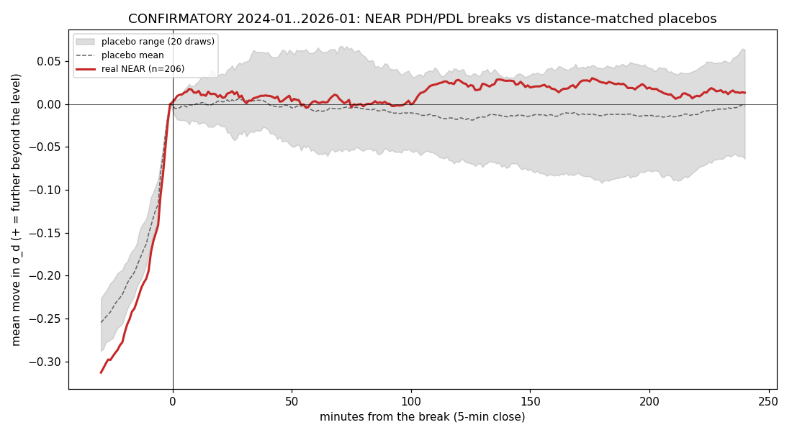

# Levels confirmation test: report

Confirmatory test of one pre-registered hypothesis on the previously sealed
data. PREREG `305d1d0`, committed after only a counts-only audit (`5b7edad`),
before any 2024+ outcome. Sealing update: `research/SEALING.md` (4dc0187,
71242b1). **2024-01-01 .. 2026-01-30 is now spent. The new seal is from
2026-10-01.** Decisions: [DECISIONS.md](DECISIONS.md). Raw output:
[results/confirm_results.json](results/confirm_results.json).

## 1. Verdict: **REJECTED**

Hypothesis: when gold breaks a PDH/PDL that was close to the day open (NEAR, 0.1
<= d <= 0.5 σ_d), the breakout fails more often than a breakout of a
meaningless price at the same distance.

| | real | distance-matched placebo | effect | 95 % CI | one-sided p (effect < 0) | MDE |
|---|---:|---:|---:|---|---:|---:|
| **NEAR** | 48.5 % continued (206 breaks) | 37.3 % (2,763 breaks) | **+11.3 pp** | [+4.0, +18.5] | **0.999** | 9.2 pp |

The claim needed effect <= −5 pp and p < 0.05. The point estimate is **positive**,
so the pre-registered mapping says **REJECTED**. More than that, the CI excludes
0 on the *other* side: in 2024–2026, breaks of near-open PDH/PDL **continued
more often** than breaks of distance-matched arbitrary prices, not less.

Data: 538 test trading days (none excluded), UTC confirmed by the audit.
`VolBlock` was fit on 2007–2023 only, with no refit. 997 eligible real levels
(337 NEAR, 660 FAR), each with 20 placebos (none short).

## 2. Specificity check (near vs far)

FAR: +3.8 pp (CI −4.1 to +11.8; 160 real / 1,113 placebo breaks). Near − far:
+7.4 pp (CI −3.3 to +18.1; p(near < far) = 0.91). The pre-registered conclusion
rule only applies to a supported main claim. For the record: there is no sign
that near-open breaks fail more than far ones.

## 3. Side claims (Asia, Late)

**Not evaluated**, as pre-registered: they are tested only if the main claim is
SUPPORTED.

## 4. Event study

After the break, real NEAR breaks drift slightly further beyond (+0.01 to +0.03
σ_d), while the placebo mean drifts slightly back and sits inside a wide band.
The mean-path difference is small; the 11 pp comes from the threshold
(first-passage) outcome. Before the break, real levels are approached **faster**
(−0.31 σ_d at −30 min vs −0.25 for placebos), which fits momentum carrying
through.

## 5. Context: the 2007–2020 exploratory estimate (not evidence)

The exploratory estimate in `research/levels` (same-day placebos, stratified by
distance) was −16 to −17 pp for the nearest levels. **The confirmatory design
reverses the sign.** The declared dry run on seen 2021–23 data, with the same
day-shifted, distance-matched design, gave +6.2 pp, the same sign as the
confirmatory result. The most likely explanation is that the earlier negative
effect was an artifact of **same-day placebos**. On a day when price breaks a
real level near the open, a same-day placebo further out only gets broken if the
move is already extended, and after that a retrace is more likely. Day-shifted
placebos at the identical distance remove that conditioning. This is a
hypothesis about the old design, not a tested claim.

## 6. Deviations, surprises, bugs

- **No deviation from PREREG.** One verdict label ("smaller than claimed") was
  added *before* the data, for a case the task's mapping left open. It wasn't
  needed.
- **One run, no reruns.** No bug was found after the run.
- **Surprise:** the direction. It matches the dry run, so the reversal against
  the old exploratory result is consistent across 2021–23 and 2024–26.
- The January 2026 range-profile flag was resolved as UTC with exact session
  edges before PREREG (audit).

## 7. Exploratory (cannot change the verdict)

Same placebos, b = 0.3 σ_d, 240 min:
- **H1 touch reaction:** NEAR −2.2 pp [−8.5, +4.4], FAR −3.5 pp [−10.9, +4.0].
- **H3 sweep-reclaim reversal:** NEAR +1.0 pp [−8.1, +10.5], FAR +7.7 pp
  [−1.9, +17.4].
- **NEAR break continuation over the barrier grid:** b 0.2 → +13.7 / +9.5 pp
  (60 / 240 min), b 0.3 → +8.6 / +11.3, b 0.5 → +3.7 / +7.1. Positive in every
  cell.
- **Reading:** none of the "levels as reversal points" ideas from the 2007–2020
  exploratory work survives in 2024–26 with distance-matched placebos. If
  anything, near-open PDH/PDL breaks carry momentum. That would be a new
  hypothesis, and it can only be tested on data from 2026-10-01 onward (sealed).
