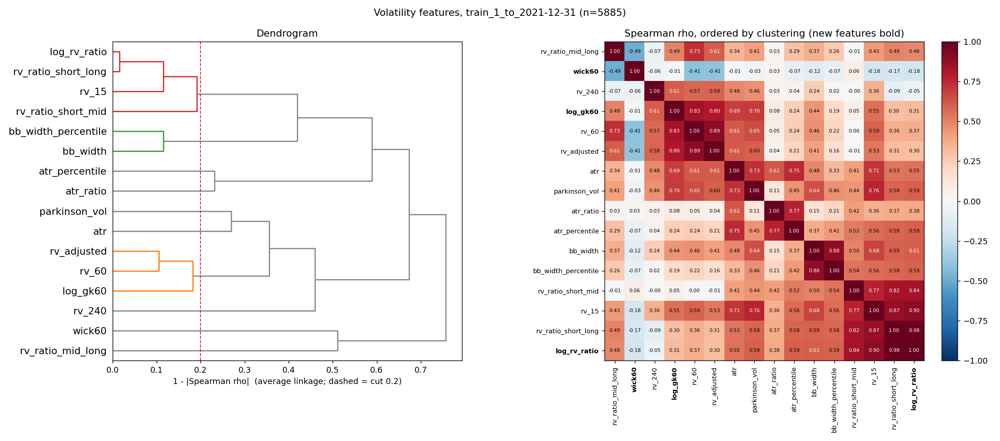
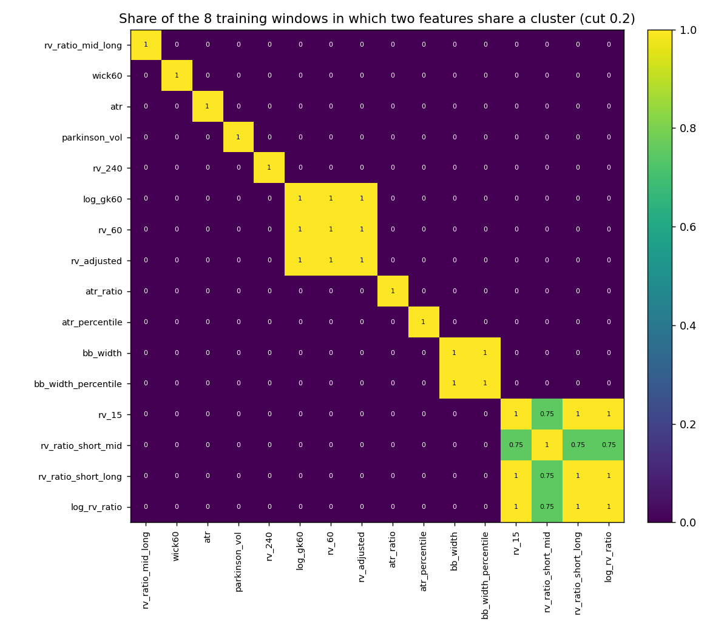

# Figures

Regenerate with `backend/venv/bin/python3 research/vol_features/run_study.py`.

## Clustering and correlations, 2021–2023 (descriptive)

Dendrogram (average linkage on 1 − |Spearman ρ|; the dashed line is the 0.2 cut)
and the correlation heatmap ordered by the clustering. The new features are in bold.

## Clustering and correlations, initial training window (2021, used for D2)

## Stability: cluster co-membership across the 8 training windows

Each cell is the share of the 8 expanding training windows in which the two
features fall in the same cluster at the 0.2 cut.

