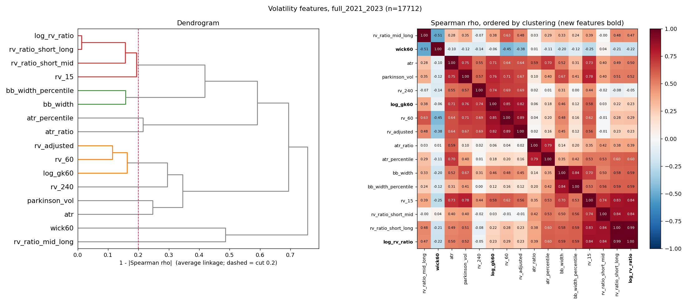

# Volatility feature reduction: report

Pre-registration: [PREREG.md](PREREG.md) (commit `5840a48`, made before any
result). Decisions: [DECISIONS.md](DECISIONS.md). Figures: [FIGURES.md](FIGURES.md).
Raw tables: [results/summary.md](results/summary.md). Data: 1H XAUUSD bars, with
2021–2023 as the analysis period and 2020 as warm-up. **No row at or after
2024-01-01 was used** (the last 1-min row is 2023-12-29 21:58, the last bar is
2023-12-29 22:00, and asserts on the loader, the bars, the analysis frame, the
model samples and the target windows all passed).

## 1. Verdict

| Rule | Result | Evidence |
|---|---|---|
| **D1** redundancy: M2 replaces M1 | **FAIL** | y4: R² 0.183 vs 0.249, which misses the −0.01 tolerance, and DM says M1 is better (−4.99, p = 3e-7). y24: R² 0.418 vs 0.405, DM p = 0.72, so y24 passes. Fails on y4. |
| **D2** distinctness (2021) | **PASS** | largest pairwise \|ρ\| = 0.313 (GK~ratio). ratio~wick = −0.181, GK~wick = −0.011 |
| **D3** M3 beats HAR (informative) | y4: **yes**, y24: **no** | y4: 0.403 vs 0.351, DM −9.06, p < 1e-19. y24: 0.470 vs 0.475, p = 0.73 |
| **D4** stability | **FAIL** | D2 holds in 8/8 windows. Signs: 4 of the 6 coefficients are 8/8 consistent, but `wick60`→y4 and `log_rv_ratio`→y24 split 4/4 (both are about 0 in size) |

**What it means for the regime classifier:** the pre-registered answer is no. The
3 features do not carry the same information as the 13, so the rules don't allow
the swap. The gap is entirely at the 4-hour horizon. At 24 hours the 3 features
match or beat the 13. The exploratory work (section 7) points to the reason: most
of the 13 features' 4-hour advantage is **time-of-day information**. Short-window
features on 1H bars partly act as a clock, and the next 4 hours of variance is
about 48 % time of day. With hour-of-day controls added to both sets, the gap is
exactly zero. For a *regime* classifier, which already has separate session
features, that time-of-day content is arguably something to remove, not keep.
That is a hypothesis for a new pre-registered test, not a result of this one.

## 2. Correlation clusters

Average linkage on 1 − |Spearman ρ|, cut at 0.2. The result is identical in the
2021 window and in 2021–2023 (n = 5,885 and 17,712).

| Cluster | Concepts (DECISIONS #14) |
|---|---|
| rv_60, rv_adjusted, **log_gk60** | LEVEL |
| rv_15, rv_ratio_short_long, rv_ratio_short_mid, **log_rv_ratio** | LEVEL/TERM |
| bb_width, bb_width_percentile | LEVEL/TERM |
| atr · parkinson_vol · rv_240 (each alone) | LEVEL |
| atr_ratio · atr_percentile · rv_ratio_mid_long (each alone) | TERM |
| **wick60** (alone) | SHAPE |

**Do the clusters match the three concepts?** Only partly. The 13 existing
features form **9 clusters**, so at |ρ| > 0.8 they are much less redundant than
assumed. They split mostly by **window length**, not by concept: 60-bar measures
group together, and the 15–20-bar ones group with the short/long ratios, because
on 1H bars a short window partly measures the hour of day (§7 A1). Each new
feature lands in the right place. `log_gk60` joins the 60-bar level cluster (ρ =
0.85 with rv_60). `log_rv_ratio` is effectively `rv_ratio_short_long` (ρ =
0.987; ρ is unchanged by the log, so the only difference is gap handling).
`wick60` joins nothing.

**The uncorrelated feature (`wick60`, max |ρ| 0.489 in 2021).** This is expected,
not an error. It is a scale-free ratio of body to range (how choppy the path
inside each bar is), not a variance, so it is unrelated to level (ρ ≈ −0.06). Its
strongest link is to `rv_ratio_mid_long` (−0.51): bars are choppier when medium
volatility is low relative to long volatility. It is also not a copy of the
classifier's existing persistence features (|ρ| ≤ 0.17 with autocorrelation,
variance ratio and Hurst; §7 A3). The tests confirm the formula (0 for
straight-line bars, 1 for bars that close at their open).

## 3. Out-of-sample results

The same rows are used for every model: y4 has 14,608 rows (9,733 test), y24 has
13,874 (9,226 test). Every feature is complete in 2021–2023, so only the target
coverage rule drops rows. Pooled over all folds (R² against each fold's training
mean; QLIKE on the variance scale, lower is better):

| | BENCH | M0 HAR | M1 13 feats | M2 3 feats | M3 HAR+3 | M4 HAR+13 |
|---|---:|---:|---:|---:|---:|---:|
| **y4** R² | 0 | 0.351 | 0.249 | 0.183 | 0.403 | **0.419** |
| y4 QLIKE | 0.418 | 0.300 | 0.313 | 0.350 | 0.271 | **0.262** |
| **y24** R² | 0 | **0.475** | 0.405 | 0.418 | 0.470 | 0.467 |
| y24 QLIKE | 0.171 | **0.091** | 0.101 | 0.099 | 0.091 | 0.092 |

DM tests (d = e²_A − e²_B, Newey–West lag 8 for y4 and 48 for y24; a negative
statistic favours A, and p is one-sided for "A is better"):

| A vs B | y4 DM (p) | y24 DM (p) |
|---|---:|---:|
| M1 vs M2 (D1) | −4.99 (3e-7) | 0.57 (0.72) |
| M3 vs M0 (D3) | −9.06 (<1e-19) | 0.61 (0.73) |
| M2 vs M0 | 14.70 (1.00) | 3.42 (1.00) |
| M1 vs M0 | 7.56 (1.00) | 3.69 (1.00) |
| M4 vs M3 | −2.89 (0.002) | 0.27 (0.60) |
| M4 vs M0 | −9.73 (<1e-20) | 0.84 (0.80) |

Per fold, each cell is R² / QLIKE:

| y4 | n | BENCH Q | M0 | M1 | M2 | M3 | M4 |
|---|---:|---:|---:|---:|---:|---:|---:|
| 2022Q1 | 1210 | 0.667 | 0.491 / 0.320 | 0.373 / 0.348 | 0.270 / 0.461 | 0.515 / 0.309 | 0.552 / 0.280 |
| 2022Q2 | 1210 | 0.259 | 0.297 / 0.201 | 0.218 / 0.217 | 0.078 / 0.251 | 0.373 / 0.177 | 0.391 / 0.175 |
| 2022Q3 | 1247 | 0.349 | 0.232 / 0.300 | 0.141 / 0.305 | 0.038 / 0.341 | 0.307 / 0.265 | 0.307 / 0.262 |
| 2022Q4 | 1210 | 0.389 | 0.208 / 0.359 | 0.112 / 0.372 | 0.037 / 0.373 | 0.215 / 0.340 | 0.234 / 0.333 |
| 2023Q1 | 1209 | 0.310 | 0.247 / 0.249 | 0.208 / 0.245 | 0.070 / 0.285 | 0.291 / 0.230 | 0.308 / 0.224 |
| 2023Q2 | 1210 | 0.371 | 0.187 / 0.320 | 0.178 / 0.295 | 0.047 / 0.350 | 0.285 / 0.280 | 0.325 / 0.262 |
| 2023Q3 | 1229 | 0.610 | 0.539 / 0.352 | 0.413 / 0.382 | 0.444 / 0.394 | 0.583 / 0.305 | 0.603 / 0.293 |
| 2023Q4 | 1208 | 0.386 | 0.277 / 0.297 | 0.073 / 0.341 | 0.096 / 0.341 | 0.357 / 0.259 | 0.320 / 0.265 |

| y24 | n | BENCH Q | M0 | M1 | M2 | M3 | M4 |
|---|---:|---:|---:|---:|---:|---:|---:|
| 2022Q1 | 1163 | 0.426 | 0.567 / 0.167 | 0.577 / 0.151 | 0.501 / 0.188 | 0.555 / 0.167 | 0.600 / 0.152 |
| 2022Q2 | 1140 | 0.066 | 0.385 / 0.045 | 0.304 / 0.052 | 0.416 / 0.042 | 0.429 / 0.042 | 0.340 / 0.050 |
| 2022Q3 | 1163 | 0.099 | 0.143 / 0.091 | 0.072 / 0.098 | 0.044 / 0.100 | 0.120 / 0.092 | 0.121 / 0.094 |
| 2022Q4 | 1160 | 0.134 | 0.141 / 0.123 | 0.062 / 0.135 | 0.119 / 0.124 | 0.156 / 0.120 | 0.127 / 0.126 |
| 2023Q1 | 1140 | 0.098 | 0.282 / 0.071 | 0.279 / 0.072 | 0.309 / 0.066 | 0.275 / 0.071 | 0.279 / 0.072 |
| 2023Q2 | 1140 | 0.102 | 0.206 / 0.077 | 0.142 / 0.083 | 0.042 / 0.092 | 0.148 / 0.084 | 0.199 / 0.078 |
| 2023Q3 | 1161 | 0.312 | 0.777 / 0.081 | 0.626 / 0.128 | 0.732 / 0.095 | 0.783 / 0.078 | 0.746 / 0.090 |
| 2023Q4 | 1159 | 0.126 | 0.358 / 0.074 | 0.281 / 0.083 | 0.247 / 0.084 | 0.343 / 0.075 | 0.344 / 0.076 |

For y4, M1 beats M2 in 6 of 8 folds. For y24 it's 4 of 8. Coefficients for every
model and fold are in [results/coefficients.csv](results/coefficients.csv).

## 4. Stability

- Cluster membership is almost fixed across the 8 training windows (co-membership
  is 0 or 1 everywhere). The one exception is `rv_ratio_short_mid`, which leaves
  the rv_15/ratio cluster in 2 of 8 windows (figure in FIGURES.md). There are 10
  or 11 clusters in every window.
- D2 holds in **8/8** windows (the largest pair ranges from 0.227 to 0.313, always
  GK~ratio).
- Standardised M2 coefficients across the 8 folds: `log_gk60` +0.26 to +0.37
  (8/8 positive, both targets). `log_rv_ratio`→y4 −0.13 to −0.16 (8/8
  negative). `wick60`→y24 +0.05 to +0.09 (8/8 positive). The failures are
  `wick60`→y4 (+0.045 falling to about −0.002: 4+/4−) and `log_rv_ratio`→y24
  (−0.014 to +0.012: 4+/4−). Both are close to zero.

## 5. Recommended volatility block (strictly by the rules)

**Keep the existing 13-feature volatility block for now.** D1 failed, so the
pre-registration gives no basis for replacing it with the 3 features. D2 did not
flag SHAPE for removal, so if a reduced set is adopted later, all three concepts
stay. This is the confirmatory answer, even though it leaves the original problem
(volatility gets 13 votes in the jump model's distance) unsolved. The way forward
is a new pre-registered test on the sealed 2024–2025 data, set up from §7: M2 vs
M1 *with hour-of-day controls* at 4h, with D1's thresholds.

## 6. Deviations, bugs, surprises

**Deviations from the task text** (all pre-registered or logged before results):
13 comparison features, not ~11 (`atr_percentile` is in the code's volatility
block). The existing features are computed as the repo computes them, with no gap
handling. Targets need 90 % minute coverage. HAR windows count bars (trading time).
D2 is judged on the 2021 window. No change was made after PREREG was committed.

**Findings in the existing feature code (`regime_features.py`):**
1. **`atr_ratio` and `atr_percentile` are largely clocks.** 44 % and 34 % of
   their variance is hour of day. Inside a regime model they push state switches
   towards session boundaries.
2. **`atr` is in dollars**, so it drifts with the gold price. It correlates only
   0.71 with the scale-free GK level.
3. **The rv windows are counts of bars**, so on 1H bars `rv_15/60/240` cover 15
   hours, 2.5 days and 10 days. The names read like minutes.
4. **No gap handling.** Close-to-close returns across the daily break and the
   weekend go into `rv_*`, and ATR's true range spans weekend gaps. The measured
   effect is small (ρ = 0.987 between the gap-clean and raw short/long ratio).
5. **Near-duplicates inside the block:** rv_60~rv_adjusted 0.89,
   rv_15~rv_ratio_short_long 0.83, rv_ratio_short_long~rv_ratio_short_mid 0.84,
   bb_width~bb_width_percentile 0.84.
6. `_periodicity_adjusted_rv` includes the current bar in its own hour-of-day
   normaliser. That is still causal and minor. The percentile features use pandas
   `rolling.apply` and are the slowest part of the block.

**Surprises.** HAR (3 log-RVs from 1-min data) beats all 13 features at both
horizons (DM p ≈ 1 for "M1 better"). The 13 features are far less redundant at
|ρ| > 0.8 than the premise assumed. No bugs were found in the study code. Two
test-file mistakes were fixed before the first run.

## 7. Amendments (exploratory, not confirmatory)

Script: `exploratory.py`, output in `results/exploratory.json`. Same rows and
folds as the pre-registered study.

- **A1: hour-of-day share of variance (η², 2021).** y4 0.48, y24 0.007.
  atr_ratio 0.44, atr_percentile 0.34, atr 0.17, log_rv_ratio 0.16,
  rv_ratio_short_mid 0.12, rv_ratio_short_long 0.10, rv_15 0.06. The 60- and
  240-bar features are all ≤ 0.03, and wick60 is 0.00.
- **A2: add 23 hour dummies (HOD) to each model.** For y4, HOD alone reaches R²
  0.412, above M0, M1 and M2. M1+HOD 0.621 vs **M2+HOD 0.623** (DM 0.16, p =
  0.56), and M3+HOD 0.677 ≈ M4+HOD 0.677 (p = 0.52). **The 4h advantage of the 13
  features is entirely time-of-day information.** For y24, M1+HOD 0.402 vs
  M2+HOD 0.420 (p = 0.78).
- **A3: wick60 vs the classifier's persistence features (2021, Spearman).**
  autocorr_lag1 0.165, variance_ratio_2 0.156, variance_ratio_5 0.107,
  hurst_dfa 0.033. It is not redundant with them.
